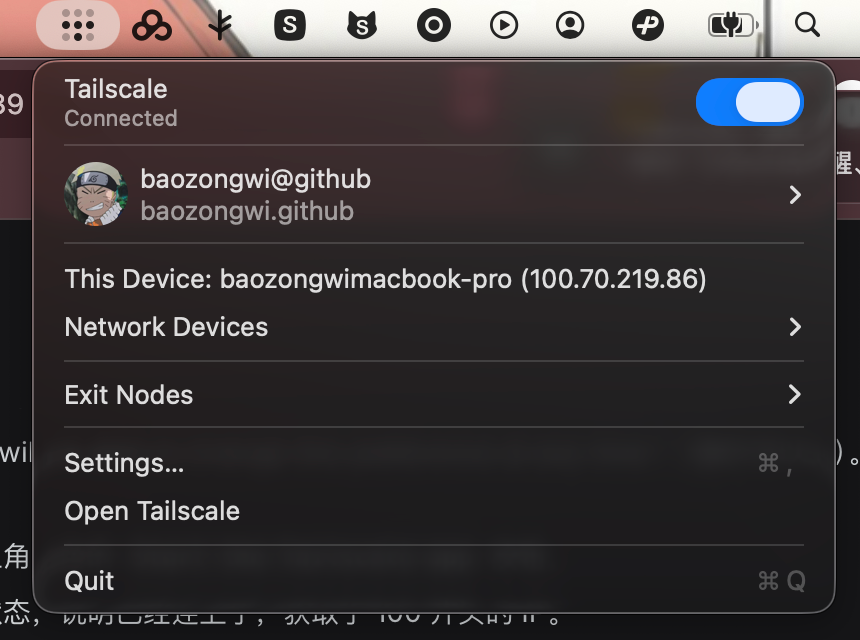
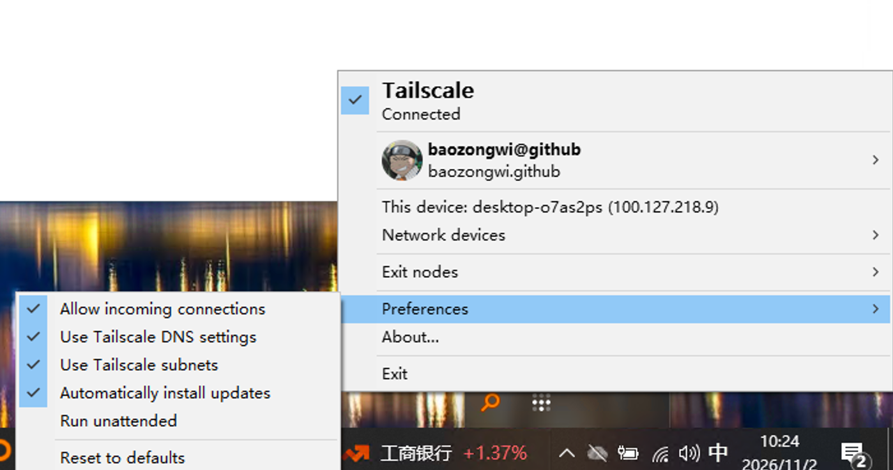
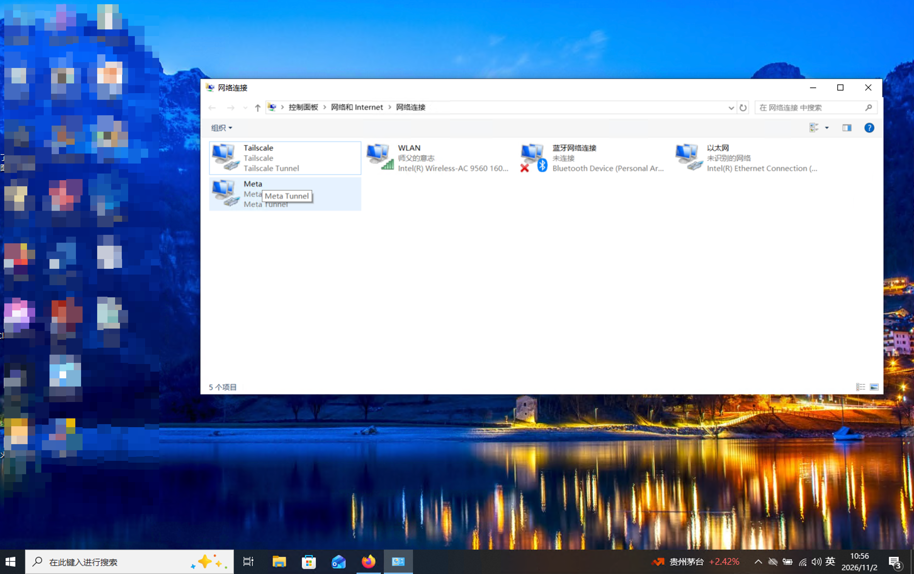
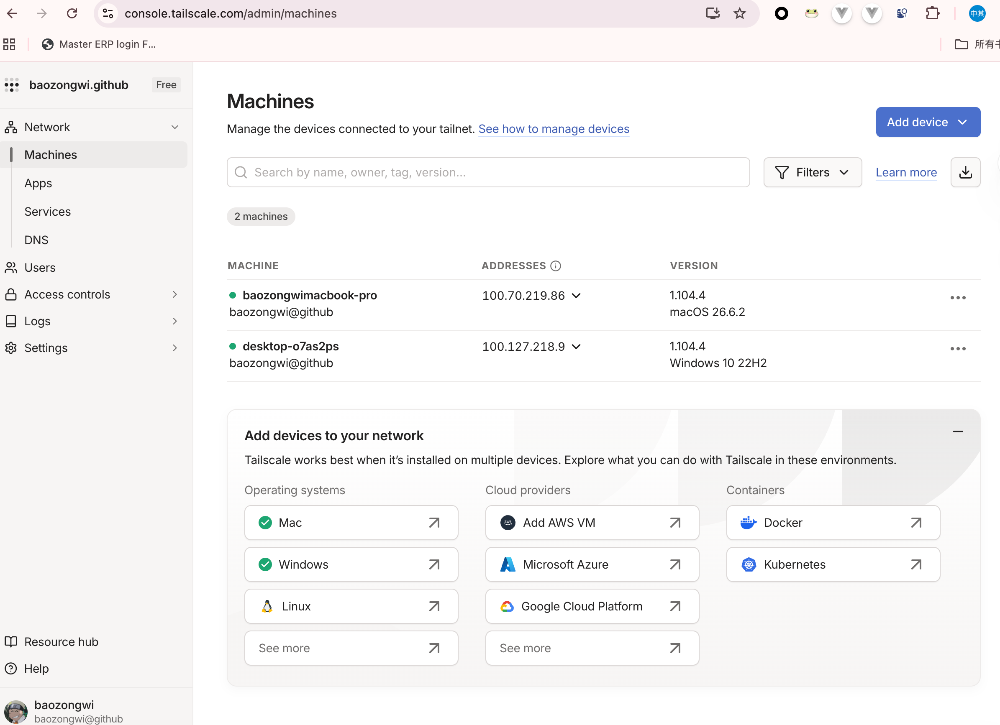

## TL;DR

有时候需要完全隔断我 Mac 的流量，所以必须用公司的 windows，虽然那玩意很卡，但是必要时还是需要用的，现在的话配置一下 RDP。

## 配置

商业远控（RustDesk/ToDesk/AnyDesk）的设计目标是"跨公网救急"，它的一切取舍都为了穿过 NAT、省带宽。而你的场景是"我自己的机器、要长期高强度使用"，这两种需求的技术栈是相反的。

| 虚拟机该有的特性 | RDP | RustDesk/ToDesk |
|---|---|---|
| 文字清晰度 | **GDI 重绘 + 近无损，锐利到像素级** | 4:2:0 有损压缩，糊 |
| 窗口缩放时分辨率自适应 | **✅ Dynamic Resolution** | ❌ 只能固定分辨率再缩放 |
| 剪贴板双向 | ✅ 原生 | ✅ 有，但常断 |
| 拖文件进去 | ✅ 驱动器重定向，直接拖 | ⚠️ 要开文件传输面板 |
| 多显示器 | ✅ 原生 | ⚠️ 支持但别扭 |
| 音频在本机播 | ✅ | ⚠️ 要看 |
| 断开后程序继续跑 | ✅ **会话保活，重连接着用** | ⚠️ 看实现 |
| 快捷键 Cmd→Ctrl 映射 | ✅ 可配 | ⚠️ 一般 |
| 延迟（局域网） | **2–8ms** | 30–200ms |
| 带宽占用 | 自适应，静态时几乎为 0 | 持续推帧 |
| 收费 | **免费** | 免费版限速/限功能 |


### Windows 端开启 RDP

先确认你的 Windows 版本

```powershell
# 在 Windows 笔记本上跑
Get-ComputerInfo | Select-Object WindowsProductName, OsHardwareAbstractionLayer
# 或者
winver
```

必须是专业版或者企业版，我本地是企业版

```powershell
# 1) 允许远程桌面
Set-ItemProperty -Path 'HKLM:\System\CurrentControlSet\Control\Terminal Server' -Name "fDenyTSConnections" -Value 0

# 2) 合盖不睡眠（这是笔记本当虚拟机用的关键，否则一合盖就断）
powercfg /setacvalueindex SCHEME_CURRENT 4f971e89-eebd-4455-a8de-9e59040e7347 5ca83367-6e45-459f-a27b-476b1d01c936 0
powercfg /setdcvalueindex SCHEME_CURRENT 4f971e89-eebd-4455-a8de-9e59040e7347 5ca83367-6e45-459f-a27b-476b1d01c936 0
powercfg /setactive SCHEME_CURRENT

# 3) 高性能模式，避免远程时降频
powercfg /setactive SCHEME_MIN

# 4) 设个固定密码 CMD 中执行
net user %USERNAME% *
```

### tailscale 组网

同一个局域网内，直接用内网 IP，稳如本地，也就是两台电脑在一块的时候直接网线互相插入，配一下手动 IP 即可，我是朱师傅帮忙配的，感谢朱师傅🥹

```powershell
ipconfig | findstr IPv4
# 建议在路由器上给这台笔记本做 DHCP 静态保留，IP 就固定了
```

不在同一网络或地区时，可以装 Tailscale，两台机器登同一账号，走 `100.x.x.x` 直连。

```bash
# Mac
brew install --cask tailscale
# Windows 下载链接
https://tailscale.com/download/windows
```



下载之后会有很多点的，就两个需要选的，分别是权限问题、自启动、接受通知，全部选择开启即可



虽然可以看到不在一个 C 段但是也没问题

```sh
baozongwi@baozongwiMacBook-Pro 印尼pluang % tailscale ping 100.127.218.9
pong from desktop-o7as2ps (100.127.218.9) via 10.55.14.123:41641 in 10ms
baozongwi@baozongwiMacBook-Pro 印尼pluang % nc -vz 100.127.218.9 3389
Connection to 100.127.218.9 port 3389 [tcp/ms-wbt-server] succeeded!
```

Tailscale 会自动打洞走 P2P（其实我也不懂。。。

### Mac 端

下载好 windows app 即可，官方商店免费下载。

```ini
# 保存为 ~/Desktop/WinBook.rdp
full address:s:100.127.218.9:3389
username:s:administer

# ---- 画质：无损优先 ----
desktopwidth:i:0
desktopheight:i:0
dynamic resolution:i:1
desktopscalefactor:i:100
bandwidthautodetect:i:0
networkautodetect:i:0
connection type:i:7
compression:i:1
autoreconnection enabled:i:1
smart sizing:i:1

# ---- 虚拟机级集成 ----
redirectclipboard:i:1
drivestoredirect:s:*
redirectprinters:i:1
audiomode:i:0
audiocapturemode:i:1
use multimon:i:1
keyboardhook:i:2
displayconnectionbar:i:1
authentication level:i:2
prompt for credentials:i:0
negotiate security layer:i:1
enablecredsspsupport:i:1
```

逐条解释几个关键项

| 参数 | 作用 |
|---|---|
| `dynamic resolution:i:1` | **拖窗口改大小，远端分辨率跟着变** —— 这条就是"虚拟机感"的来源，很多客户端没开 |
| `bandwidthautodetect:i:0` + `connection type:i:7` | 关掉自适应降质，强制按局域网最高画质 |
| `drivestoredirect:s:*` | 把 Mac 的盘符挂进 Windows，**可以直接把文件拖进窗口** |
| `audiomode:i:0` | 声音在 Mac 音箱放，不在笔记本放 |
| `use multimon:i:1` | 多显示器全用上 |
| `keyboardhook:i:2` | Cmd 自动映射成 Win 键，用起来跟本地一样 |
| `compression:i:1` | 局域网可开压缩，文字更锐利（带宽够就别改成 0） |

**再加一个 Mac 端的快捷键习惯**：Mac 的 RDP 客户端会把 `Cmd` 映射为 `Win`，`Cmd+C/V` 直接就是复制粘贴，`Cmd+Tab` 是切 Windows 应用 —— 用半小时就忘了这是远程。


## 最终配置单

```
Windows 笔记本（放在家里/公司，插电，网线优先）
├─ 升级专业版 → 开 RDP
├─ 合盖不休眠 + 高性能电源计划
├─ 路由器 DHCP 保留固定 IP
├─ Tailscale（外出也能连）
└─ OBS（需要录屏时本地录）

Mac（你的主控台）
├─ Microsoft Windows App（RDP 客户端）
├─ WinBook.rdp（上面的配置，丢桌面双击直连）
├─ Moonlight（需要看视频/玩游戏/看到本地屏幕时用）
└─ Tailscale（同一账号，自动 P2P）
```


